<p align="center">
<picture>
<source media="(prefers-color-scheme: dark)" srcset="docs/logo/logo-dark.svg">

</picture>
</p>

# cOS - A Modern Operating System

Winner of the Hack Club Arcade Showcase 2024, out of over 2000 projects. 

Winner of RakHack 2024.

## Background

I have recently started taking an interest in the low-level implementation details of operating systems for computers. The operating system is system software that manages the computer system and provides services to programs. It consists of a kernel that has full control of the computer system and other loadable modules such as a networking layer.
Some of the responsibilities of the kernel include:

- Managing physical memory
- Managing virtual address spaces (paging)
- Scheduling and switching between programs
- Handling hardware and software interrupts
- Setting up architecture-specific structures
- Loading programs in and out of memory


Currently there are only a few mainstream operating systems: Microsoft Windows, macOS and Linux. Each of these operating systems is over 20 years old and is well supported by most commercial software.


## Project Outline

Mainstream operating systems contain millions of lines of code and retain design constraints for backwards compatibility, which makes them difficult to study as complete systems. Teaching systems such as MINIX and xv6 deliberately use a smaller scope. cOS explores a different point in that design space by implementing an x86-64 kernel, user-space processes, a virtual filesystem and a TCP/IP stack in one project.
The project began as a way to understand computer architecture and operating-system implementation. It also provides students with a worked example of how paging, interrupts, scheduling, system calls, filesystems and networking fit together.

## Building and Running

You will need an `x86_64-elf` cross-compiler, NASM, CMake, GRUB (`grub-mkrescue` for the `i386-pc` platform), xorriso, mtools and QEMU. The Dockerfile in `buildenv` builds the cross-compiler; on macOS, Homebrew has all of them (`x86_64-elf-gcc nasm cmake i686-elf-grub xorriso mtools qemu`).

```
cmake -B build
cmake --build build
cmake --build build --target run
```

This builds `build/cOS.iso` and boots it in QEMU with the AMD PCnet network card. Files placed in `targets/x86_64/initrd` are packed into the initial ramdisk, and the kernel opens them by their path in the ramdisk, such as `initrd/hello.txt`. User-space programs in `userspace` are compiled into `initrd/bin`, and cOS boots into the user shell, `initrd/bin/sh`.

The build also makes `build/disk.img`, a FAT32 disk containing the files in `targets/x86_64/disk`, which the kernel mounts at `disk/`. Files that cOS writes to the disk are kept between runs, and can be read on the host with mtools, for example `mtype -i build/disk.img ::notes.txt`.

`toolchain/build-cos-toolchain.sh` builds a cross compiler for cOS itself, binutils 2.42 and GCC 14.2 for the `x86_64-cos` target, from the patches in `toolchain/patches`. This is the first step towards building GCC to run inside cOS. It needs a Linux machine, and takes about 15 minutes with 16 cores:

```
toolchain/build-cos-toolchain.sh <work directory> <install prefix> [jobs]
```

`toolchain/build-cos-newlib.sh` then builds the newlib C library into the toolchain's sysroot, along with `libcos` (`userspace/libcos`), which gives newlib the cOS system calls it needs, such as `read`, `write` and `sbrk`. libcos also provides `mkdir`, `unlink`, `posix_spawn` and `waitpid`, and programs receive environment variables from the program that started them. Ordinary C programs, using `printf`, `malloc` and `FILE`, can then be compiled for cOS and copied into `targets/x86_64/initrd/bin`:

```
toolchain/build-cos-newlib.sh <work directory> <install prefix> [jobs]
x86_64-cos-gcc -O2 program.c -o program
```

## Project Specification

These are checkboxes, but I will probably only review these guidelines at the end to check them off, rather than iteratively during the project. These are mostly for my own reference.

_Edit: Quoted items are my evaluation of this completed checklist, with links to evidence._

### cOS Kernel

- [x] - The kernel boots successfully.
  - [x] - The kernel boots on x86-64 compatible machines.
  - [x] - The kernel is bootable by any Multiboot-2 compliant bootloader.

  > The kernel boots successfully across different virtualisation software. As a result, it should also work on physical hardware, although I have not tested this. This is also demonstrated in testing by test 1.1.
  
- [x] - The kernel can parse a Multiboot-2 header.

  > This is demonstrated by being able to detect physical memory by reading the header, as in test 1.2. Certain fields however are not explicitly parsed, and the length of physical memory is assumed to be equal to the end memory address of physical memory.

- [x] - The kernel sets up paging.
  - [x] - 4-level paging

> Paging is functional and the whole of physical memory is mapped into the main address space. The kernel exposes a simple interface for applications to map virtual pages to physical pages or allocate virtual pages. It also handles page faults for user-space programs by copying pages from the main address space into the user-space address space if available. Tests 1.3 and 1.5 verify that the paging structures are properly set up.

- [x] - The kernel can load a Multiboot-2 module.

> The initial ramdisk is loaded as a module and the physical pages are protected from being overwritten. The kernel also maps the module into the address space at a fixed address. It can currently only use a single module; however, it still prevents other modules from being overwritten in memory.
      
- [x] - The kernel sets up x86-64 specific structures:
  - [x] - A Global Descriptor Table (GDT)
  - [x] - A Task State Segment (TSS)
  - [x] - An Interrupt Descriptor Table (IDT)

    > The Global Descriptor Table and Task State Segment are both managed and set up by the kernel. The Global Descriptor Table contains entries for different protection levels: ring 0 and ring 3. This helps protect the operating system from malicious or buggy user-space programs. Ring 1 and 2 could possibly be used for device drivers to provide less protection than user-space while retaining more protection than kernel-level execution. These have been checked by tests 1.4 and 1.6.
- [x] - The kernel enters long mode.

> The kernel jumps to a higher half 64-bit address which is where 64-bit code begins execution.
> 
- [x] - The kernel loads an initrd.

> The initrd is loaded from a Multiboot-2 module. It is in the form of a Unix Standard TAR file which is parsed and accessible from the virtual filesystem. Tests 2.4 and 2.5 demonstrate this. System files and drivers can be included in the initrd. The TAR file is uncompressed so it may be worth using a compressible format to reduce image sizes.

- [x] - The initrd is loaded as a Multiboot-2 module.
- [x] - The initrd is a Unix Standard TAR file.
- [x] - The kernel initialises interrupts.

> The Interrupt Descriptor Table is set up to call a custom interrupt handler, as verified in test 1.6. This uses virtual functions to find a relevant interrupt handler and call it. As a result, device drivers can easily handle interrupts by inheriting from the interrupt handler class. The Programmable Interrupt Controller (PIC) has also been set up as verified in test 1.7, and hardware interrupts are received in test 1.8. In the future, the Advanced Programmable Interrupt Controller (APIC) could support multiprocessor interrupt routing.

- [x] - The kernel initialises the Programmable Interval Timer (PIT).

> The PIT provides a global timer that is used for processes to sleep for a certain number of milliseconds. The interrupt itself is used to check if tasks can be switched and allows us to interrupt a malfunctioning program. Higher precision timers could be used to gain an even better global timer.

- [x] - The kernel initialises a kernel heap that can allocate and free arbitrarily sized buffers.
  - [x] - It must be able to supply word-aligned allocations.

  > The heap allocator works effectively and has been tested. It is used extensively in the kernel and therefore it is crucial that it is performant. The use of a binary search tree over a regular list of free allocations significantly improves performance. Rebalancing the binary search tree would likely further increase performance.

- [x] - The kernel initialises a scheduler that can switch between kernel tasks.
  - [x] - The kernel must also provide a mechanism to switch to user mode. (ring 3)

  > Task switching uses interrupt stacks to store the state of an interrupted task and restore state when resuming the task. The task switching is able to switch between kernel and user-space processes efficiently. In addition, the scheduler chooses which task should run next using a priority-based system. This has been tested in tests 4.1 through 4.6. Alternative scheduler designs might lead to a fairer and more performant scheduler.
  
- [x] - The kernel detects devices on Peripheral Component Interconnect (PCI) buses.
  - [x] - The kernel provides the ability to search for and configure devices on PCI buses.

  > All devices were detected in test 2.3. The network driver also configures the network card on the PCI bus successfully.

### cOS filesystem layer

- [x] - The layer provides an interface for multiple filesystems mounted in a single virtual filesystem.
  - [x] - It provides an implementation for a driver for the USTAR tar file format.

  > The virtual filesystem can easily mount new filesystems with a simple interface. It can abstract file operations on a tree structure regardless of the underlying structure of the file. This is seen in the flat TAR file being mapped into a tree of file and directory nodes.

- [x] - The layer provides `read` and `write` interfaces for filesystem drivers.

> Filesystem drivers only need to provide a single interface to be mountable in the virtual filesystem. This also means that drivers for other operating systems can easily be ported and executed. 

### cOS networking layer

- [x] - The kernel can provide networking services.
  - [x] - It provides an adaptable interface for different network card drivers.
    - [x] - It provides an implementation for the AMD Am79C973 network card.
  - [x] - It provides an interface for sending and receiving Ethernet frames.
  - [x] - It provides an interface for sending and receiving Address Resolution Protocol (ARP) messages.
  - [x] - It provides an interface for handling Internet Protocol v4 (IPv4) messages.
  - [x] - It provides an interface for sending and receiving Internet Control Message Protocol (ICMP) messages.
  - [x] - It provides an interface for sending and receiving User Datagram Protocol (UDP) messages.
  - [x] - It provides an interface for sending and receiving Transmission Control Protocol (TCP) messages.
    - [x] - It supports reordering of received packets.
    - [x] - It supports acknowledgment and retransmission of missed packets.
       
  > The networking stack is very functional and provides a TCP/IP implementation with support for sockets. It exposes hardware-level communication as well as higher-level socket communication. It even allows for accessing the Internet through HTTP, which is a very complex procedure. Tests 3.1 to 3.8 all passed and demonstrated the strength and compliance of the networking stack. It would be useful to port an SSL/TLS library so that HTTPS can be used to access modern websites. Making the network stack multi-threaded with queues would also be valuable, especially for server applications. 

### cOS user-space

- [x] - The kernel can load ELF executables into an address space for a newly created task.

> This has been demonstrated with test 4.4. Static ELF executables can be completely loaded in and executed in accordance with the ELF specification. Relocatable ELF executables are not currently supported.

- [x] - The kernel provides a system calls interface to send data to the kernel.

> This uses the built-in `syscall` instruction, storing arguments in registers. This is very fast as it avoids some of the overhead of interrupts. Currently there are not many system calls available. Care must be taken to ensure all data coming from user-space is treated as untrustworthy and scrutinised with defensive programming.

## Design

My project will be to create an operating system (cOS) that runs on modern hardware and is able to run user-space programs. The project will consist of the following sections:

- The core kernel that is responsible for initialising and managing the processor, handling hardware operations and memory, executing and switching between processes, and providing services to processes.
- The filesystem layer that is responsible for providing a virtual filesystem interface for processes to access files in a concrete filesystem agnostic manner.
- The networking layer that is responsible for managing network operations and sockets by interfacing with the network card driver and managing various networking protocol stacks.
- The user-space in which most user programs execute with C Library support. This is separated from the kernel using the protection mechanisms provided by the processor.

### Target Architecture

The instruction set architecture which generally defines how software controls the computer processor. Although most architectures have a similar processing model, with interrupt and virtual memory support, they also have differences that mean they are not interoperable. They also have different machine code instructions (instruction sets) so must be recompiled with different binaries targeting different architectures. The x86 is the most used computer architecture in the world, with the x86-64 being the modern 64-bit adaptation that is supported by most mainstream operating systems. This architecture, as a result, has extensive documentation and has two systems programming manuals written for it: the Intel manual and the AMD manual. This makes it a suitable choice for an investigative project into modern operating systems. Another contender is the ARM 64-bit architecture (AArch64 or ARM64). This is a newer architecture that is most commonly used in mobile applications. There is not as much documentation available for the ARM architecture and it is not as widely used for desktop personal computers. As a result, we target the x86-64 architecture for our operating system.

### Cross Compilation

The default system compilers make assumptions about the host machine (the machine that the program will run on), such as whether it has support for dynamic loading and whether it is freestanding. As a result, we must compile our own cross-compiler.
A cross-compiler is a compiler where the target machine (the machine that the binaries will execute on) is different from the host machine (the machine that runs the compiler). Our target machine will be running cOS, however we do not have a compiler that runs on cOS! We make a generic cross-compiler that targets a generic x86-64 machine with no operating system in order to build our operating system. We use `gcc` as our compiler, and our target is `x86_64-elf` (we can eventually create our own toolchain and our target will be `x86_64-cos`). We will also build this using a Docker container, as this allows our build process to be easily reproducible by anyone. A deep dive into the build process is beyond the scope of this documentation.

### Hierarchy Charts

We show hierarchy charts for each part of the operating system, followed by a table describing the function of each module.

### Kernel

<p align="center">
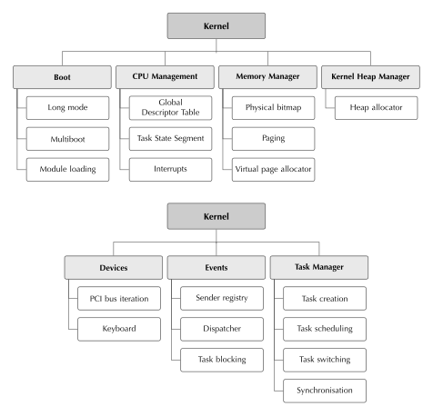
</p>


<table>
  <tr>
    <td colspan="2">
  <div style="display: flex; justify-content: center; align-items: center; height: 100%;">
    <strong>Kernel</strong>
  </div>
</td>
   </td>
  </tr>
  <tr>
   <td><strong>Module</strong> 
   </td>
   <td><strong>Function</strong> 
   </td>
  </tr>
  <tr>
   <td><strong>Boot</strong> 
   </td>
   <td><strong>Sets up the execution environment for the kernel. This involves initialising the processor and other hardware to run 64-bit code. </strong> 
   </td>
  </tr>
  <tr>
   <td>Long mode 
   </td>
   <td>Sets up temporary paging structures that map physical memory at a high address as a prerequisite for entering long mode. Then long mode can be enabled on the processor and a far jump can be made to the 64-bit entry point, which calls the kernel’s main C++ entry point. 
   </td>
  </tr>
  <tr>
   <td>Multiboot 
   </td>
   <td>Parses the Multiboot 2 header and allows the kernel to iterate through relevant Multiboot 2 tags with a custom class. 
   </td>
  </tr>
  <tr>
   <td>Module loading 
   </td>
   <td>Iterates through Multiboot 2 module tags and ensures that they are not overwritten by kernel data by passing their memory addresses to the memory manager. 
   </td>
  </tr>
  <tr>
   <td><strong>CPU Management</strong> 
   </td>
   <td><strong>Sets up more architecture specific structures such as the Global Descriptor Table and Task State Segment. This also enables hardware and software interrupts, as well as a timer.</strong> 
   </td>
  </tr>
  <tr>
   <td>Global Descriptor Table 
   </td>
   <td>The GDT contains descriptors for different memory segments as well as the TSS. We set up the GDT with entries for ring 0 code, ring 0 data, ring 3 code, and ring 3 data. These segments cover the whole of memory in long mode. 
   </td>
  </tr>
  <tr>
   <td>Task State Segment 
   </td>
   <td>The TSS is used in long mode to load the stack pointer when a privilege change occurs. We set up an empty TSS that we later install with a kernel stack pointer when a task switch occurs. 
   </td>
  </tr>
  <tr>
   <td>Interrupts 
   </td>
   <td>An Interrupt Descriptor Table is required to enable interrupts, which contains entries for each interrupt vector. To receive interrupts, classes can use inheritance to conform as interrupt handlers, causing a pointer to a member function being installed in the IDT. Additionally, the Programmable Interrupt Controller is initialised to receive hardware interrupts, and the Programmable Interval Timer is also enabled. 
   </td>
  </tr>
  <tr>
   <td><strong>Memory Manager</strong> 
   </td>
   <td><strong>Manages both physical memory and virtual memory address spaces, providing an abstracted interface to the rest of the kernel.</strong> 
   </td>
  </tr>
  <tr>
   <td>Physical bitmap 
   </td>
   <td>Physical memory is divided into 4KiB pages, and a bitmap records which pages are being used. The kernel memory region and module regions are set to being used. To find a free page, we iterate through the bitmap to find the first unset bit and convert the bit number into a page address. 
   </td>
  </tr>
  <tr>
   <td>Paging 
   </td>
   <td>New paging structures are initialised to map physical memory as well as modules into a master kernel address space. We manage page tables by allocating physical memory for them and deallocating them when they are no longer needed. We can also change address spaces by changing the CR3 register. 
   </td>
  </tr>
  <tr>
   <td>Virtual page allocator 
   </td>
   <td>The page allocator is used to allocate a physical page and then map it into a given address space at a logical address. 
   </td>
  </tr>
  <tr>
   <td><strong>Kernel Heap Allocator</strong> 
   </td>
   <td><strong>Manages a heap of memory allocations that can be arbitrarily sized.</strong> 
   </td>
  </tr>
  <tr>
   <td>Heap allocator 
   </td>
   <td>Allows the kernel to request memory allocations. When this happens, the heap allocator allocates physical memory pages if needed and then finds an available memory space to partition for the allocation. 
   </td>
  </tr>
  <tr>
   <td><strong>Devices</strong> 
   </td>
   <td><strong>Manages the Peripheral Component Interconnect and interrupt-based or I/O-based devices</strong> 
   </td>
  </tr>
  <tr>
   <td>PCI bus iteration 
   </td>
   <td>Provides an interface to use the PCI bus. Detects all devices on the PCI bus that drivers can use to configure and communicate with the devices. 
   </td>
  </tr>
  <tr>
   <td>Keyboard 
   </td>
   <td>PS/2 keyboards send interrupts which we handle, reading the scan-codes from an I/O port.  
   </td>
  </tr>
  <tr>
   <td><strong>Events</strong> 
   </td>
   <td><strong>The Events system allows for tasks to register to receive messages from event senders. </strong> 
   </td>
  </tr>
  <tr>
   <td>Sender registry 
   </td>
   <td>Classes can use inheritance to register as an event sender. They manage process wait and listen queues, waking and broadcasting event messages to these processes when needed. 
   </td>
  </tr>
  <tr>
   <td>Dispatcher 
   </td>
   <td>The dispatcher is responsible for signalling to processes when an event message has been sent. This includes modifying wait and listen queues when necessary. 
   </td>
  </tr>
  <tr>
   <td>Task blocking 
   </td>
   <td>Tasks can choose to wait for an event message. This blocks the task (stops from being scheduled) until the dispatcher dispatches an event message to them, preventing them from wasting processor time. 
   </td>
  </tr>
  <tr>
   <td><strong>Task Manager</strong> 
   </td>
   <td><strong>Performs pre-emptive multitasking by switching between tasks according to a scheduler.</strong> 
   </td>
  </tr>
  <tr>
   <td>Task creation 
   </td>
   <td>Creating new resources such as an address space, file descriptor/event descriptor tables, and a stack. Starts a task by faking an interrupt stack and returning from it. 
   </td>
  </tr>
  <tr>
   <td>Task scheduling 
   </td>
   <td>Uses a scheduler to choose the next task that should execute on the processor. This is talked about in more detail later. 
   </td>
  </tr>
  <tr>
   <td>Task switching 
   </td>
   <td>Uses interrupts to switch between tasks; the stack pointer is switched to the new task’s stack pointer and returning from the interrupt executes the new task. 
   </td>
  </tr>
  <tr>
   <td>Synchronisation 
   </td>
   <td>Provides synchronisation primitives. This includes a spinlock, which disables interrupts and busy-waits if the lock is acquired. Also provides a mutex that blocks a task if it is already acquired and adds it to a wait queue that is awoken when the mutex is released. 
   </td>
  </tr>
</table>

### Filesystem Layer

<p align="center">
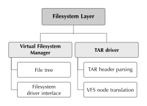
</p>


<table>
  <tr>
   <td colspan="2" ><strong>Filesystem Layer</strong> 
   </td>
  </tr>
  <tr>
   <td><strong>Module</strong> 
   </td>
   <td><strong>Function</strong> 
   </td>
  </tr>
  <tr>
   <td><strong>Virtual Filesystem Manager</strong> 
   </td>
   <td><strong>Acts as the main interface for handling files. Manages a tree structure of files and redirects file handling operations to the relevant filesystem driver.</strong> 
   </td>
  </tr>
  <tr>
   <td>File tree 
   </td>
   <td>The file tree consists of directories and files that are arranged using nodes. Each node can have child nodes and are dynamically allocated when a directory or file is requested. 
   </td>
  </tr>
  <tr>
   <td>Filesystem driver interface 
   </td>
   <td>Provides a standard interface for opening, reading, writing, and closing files. Each function calls the function for the underlying driver. This will be implemented using virtual functions and inheritance. 
   </td>
  </tr>
  <tr>
   <td><strong>TAR driver</strong> 
   </td>
   <td><strong>Reads Unix Standard TAR files and mounts the initial ramdisk as a concrete filesystem.</strong> 
   </td>
  </tr>
  <tr>
   <td>TAR header parsing 
   </td>
   <td>TAR headers are 512-byte aligned, and these headers contain various metadata about each file in the TAR archive. These headers are parsed and stored so that the contents of files can be accessed. 
   </td>
  </tr>
  <tr>
   <td>VFS node translation 
   </td>
   <td>The driver is responsible for converting the flat, sequential storage of files into a node-based tree of files and directories so that the Virtual Filesystem can interpret them. This is done dynamically as the Virtual Filesystem calls for file operations. 
   </td>
  </tr>
</table>

### Networking layer

<p align="center">
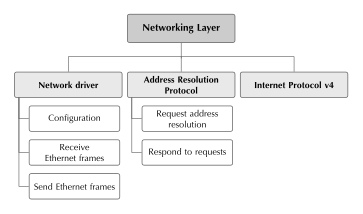
</p>

<table>
  <tr>
   <td colspan="2" ><strong>Networking Layer</strong> 
   </td>
  </tr>
  <tr>
   <td><strong>Module</strong> 
   </td>
   <td><strong>Function</strong> 
   </td>
  </tr>
  <tr>
   <td><strong>Network driver</strong> 
   </td>
   <td><strong>Communicates with a network card to send and receive data over a network.</strong> 
   </td>
  </tr>
  <tr>
   <td>Configuration 
   </td>
   <td>Configures the network driver to send and receive Ethernet II frames. This involves configuring the PCI device and sending commands through I/O ports to enable the device.  
   </td>
  </tr>
  <tr>
   <td>Receive Ethernet frames 
   </td>
   <td>Allocates a circular buffer in physical memory to receive Ethernet frames. Informs the network card and maps it into the virtual address space. It also enables interrupts to receive on the device. 
   </td>
  </tr>
  <tr>
   <td>Send Ethernet frames 
   </td>
   <td>Allocates a circular buffer in physical memory to send Ethernet frames. Informs the network card and maps it into the virtual address space. 
   </td>
  </tr>
  <tr>
   <td><strong>Address Resolution Protocol</strong> 
   </td>
   <td><strong>Implements the Address Resolution Protocol for translating Internet Protocol version 4 addresses to MAC addresses.</strong> 
   </td>
  </tr>
  <tr>
   <td>Request address resolution 
   </td>
   <td>Sends an ARP request and waits to receive a response. Processes the response and caches MAC addresses that have already been resolved in a hash map. 
   </td>
  </tr>
  <tr>
   <td>Respond to requests 
   </td>
   <td>If the network card’s IP address is equal to the request’s resolution address, respond with an ARP response containing the network card’s MAC address. 
   </td>
  </tr>
  <tr>
   <td><strong>Internet Protocol v4</strong> 
   </td>
   <td><strong>Receive and send Internet Protocol v4 packets, forwarding them to specific IPv4 protocol handlers. This is done using inheritance, which registers a protocol handler in the main IPv4 class.</strong> 
   </td>
  </tr>
</table>

### Internet Protocol v4

<p align="center">
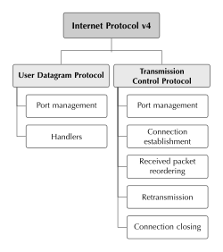
</p>

<table>
  <tr>
   <td colspan="2" ><strong>Internet Protocol v4</strong> 
   </td>
  </tr>
  <tr>
   <td><strong>Module</strong> 
   </td>
   <td><strong>Function</strong> 
   </td>
  </tr>
  <tr>
   <td><strong>User Datagram Protocol</strong> 
   </td>
   <td><strong>Implements the User Datagram Protocol using sockets.</strong> 
   </td>
  </tr>
  <tr>
   <td>Port management 
   </td>
   <td>Uses a class to represent a port that can send and receive data by calling the relevant UDP functions. 
   </td>
  </tr>
  <tr>
   <td>Handler 
   </td>
   <td>Classes can use inheritance to call a function upon receiving UDP messages on a port. 
   </td>
  </tr>
  <tr>
   <td><strong>Transmission Control Protocol</strong> 
   </td>
   <td><strong>Implements the Transmission Control Protocol using sockets.</strong> 
   </td>
  </tr>
  <tr>
   <td>Port management 
   </td>
   <td>Uses a class to represent a port that can send and receive data by calling the relevant TCP functions. 
   </td>
  </tr>
  <tr>
   <td>Connection establishment 
   </td>
   <td>Can passive open or connect to a server, establishing a connection with a three-way handshake, sending SYN packets, and managing state. 
   </td>
  </tr>
  <tr>
   <td>Received packet reordering 
   </td>
   <td>Uses a buffer to hold received packets and reorder them by sequence number. Sends to the application layer when there is a sequential number of packets, and the acknowledgement number is updated. 
   </td>
  </tr>
  <tr>
   <td>Retransmission 
   </td>
   <td>Uses a buffer to hold transmitted packets and starts a timer to retransmit them if the receiver does not acknowledge them. 
   </td>
  </tr>
</table>

### Userspace

<p align="center">
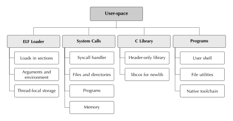
</p>

<table>
  <tr>
   <td colspan="2" ><strong>User-space</strong> 
   </td>
  </tr>
  <tr>
   <td><strong>Module</strong> 
   </td>
   <td><strong>Function</strong> 
   </td>
  </tr>
  <tr>
   <td><strong>ELF Loader</strong> 
   </td>
   <td><strong>Loads an ELF file to be executed as a task.</strong> 
   </td>
  </tr>
  <tr>
   <td>Loads in segments 
   </td>
   <td>Loads in program executable segments into a task’s address space. 
   </td>
  </tr>
  <tr>
   <td><strong>System Calls</strong> 
   </td>
   <td><strong>Implements a system calls interface for user-space processes to request services from the operating system.</strong> 
   </td>
  </tr>
  <tr>
   <td>Syscall handler 
   </td>
   <td>Executes when <code>syscall</code> is called. Takes arguments from registers loaded by the user-space program. Calls various kernel functions to execute syscall 
   </td>
  </tr>
</table>

## Testing

I will test using white-box testing, as black-box testing would not be appropriate for the kernel. Instead, code segments are run in the kernel or as processes. 

### Processor Initialisation 

It is the operating system’s responsibility to properly initialise the processor to be able to execute code at various privilege levels, receive interrupts and use virtual memory addressing. To execute the operating system, I will use virtualisation software to emulate real hardware. I will be using QEMU.

<table>
  <tr>
   <td>Test ID 
   </td>
   <td>Description 
   </td>
   <td>Expected result 
   </td>
  </tr>
  <tr>
   <td>1.1 
   </td>
   <td>The operating system will boot. This is tested by running in QEMU. 
   </td>
   <td>The operating system boots without a General Protection Fault. 
   </td>
  </tr>
  <tr>
   <td>1.2 
   </td>
   <td>All physical memory is detected by the operating system. This is tested by outputting the memory region map and comparing to QEMU’s input parameters. 
   </td>
   <td>The regions of physical memory correspond to the QEMU memory length. 
   </td>
  </tr>
  <tr>
   <td>1.3 
   </td>
   <td>Physical memory is loaded into the virtual memory address space. This is tested by printing the contents of a virtual memory address corresponding to <code>0x1000</code> and comparing to a debug log of physical memory contents. 
   </td>
   <td>The virtual memory access matches the physical memory access. 
   </td>
  </tr>
  <tr>
   <td>1.4 
   </td>
   <td>The GDT is loaded with a valid entry. This is tested by checking the QEMU monitor GDT register (GDTR). 
   </td>
   <td>The GDTR holds a valid GDT address as reported by QEMU. 
   </td>
  </tr>
  <tr>
   <td>1.5 
   </td>
   <td>Page allocation is functional. This is tested by allocating address <code>0x1000</code>.  
   </td>
   <td>Without allocating, a page fault occurs. After allocating, no page fault occurs on access.  
   </td>
  </tr>
  <tr>
   <td>1.6 
   </td>
   <td>The IDT is loaded with a valid entry. This is tested by checking the QEMU monitor IDT register (IDTR). 
   </td>
   <td>The IDTR holds a valid IDT address as reported by QEMU. 
   </td>
  </tr>
  <tr>
   <td>1.7 
   </td>
   <td>The Programmable Interrupt Controller is initialised and remapped to <code>0x20</code> (PIC0) and <code>0x28</code> (PIC1). This would be tested by reading the QEMU monitors PIC offsets. 
   </td>
   <td>The PIC offsets are remapped. 
   </td>
  </tr>
  <tr>
   <td>1.8 
   </td>
   <td>Hardware interrupts call the interrupt handler. This is tested by typing in the shell, which receives each key from the keyboard interrupt handler. 
   </td>
   <td>The typed characters are printed on the screen. 
   </td>
  </tr>
  <tr>
   <td>1.9 
   </td>
   <td>Unmapped pages cause page fault. This is tested by attempting to access an unmapped page in low memory. 
   </td>
   <td>A page fault occurs. 
   </td>
  </tr>
</table>

### Kernel Resource Management

I will also test that the kernel manages hardware resources properly. This includes the kernel heap, the PCI bus and the virtual filesystem.


<table>
  <tr>
   <td>Test ID 
   </td>
   <td>Description 
   </td>
   <td>Expected result 
   </td>
  </tr>
  <tr>
   <td>2.1 
   </td>
   <td>The kernel heap allocations can be filled with data and is not overwritten with successive allocations. This is tested by ensuring data stored in an allocation remains the same. 
   </td>
   <td>The allocation data is not overwritten. 
   </td>
  </tr>
  <tr>
   <td>2.2 
   </td>
   <td>Allocations larger than a page can be made. This is tested by allocating <code>8192</code> bytes. 
   </td>
   <td>The kernel does not crash or raise any exception. 
   </td>
  </tr>
  <tr>
   <td>2.3 
   </td>
   <td>All devices on the PCI bus are detected. This is tested by comparing the detected devices to the QEMU monitor PCI devices. 
   </td>
   <td>All devices are the same. 
   </td>
  </tr>
  <tr>
   <td>2.4 
   </td>
   <td>Reading files from initial ramdisk (initrd). This is tested by placing a file inside the initrd and reading it. 
   </td>
   <td>The displayed contents is the same as the file content. 
   </td>
  </tr>
  <tr>
   <td>2.5 
   </td>
   <td>Read files inside directories from initial ramdisk. This is tested by placing a directory inside the initrd and reading it. 
   </td>
   <td>The displayed contents is the same as the file content 
   </td>
  </tr>
  <tr>
   <td>2.6 
   </td>
   <td>Event dispatching works. This is tested by receiving keyboard events in a task. 
   </td>
   <td>The keyboard scan-codes are printed on the screen by the task. 
   </td>
  </tr>
  <tr>
   <td>2.7 
   </td>
   <td>Reading files from a FAT32 disk. This is tested by placing a file on the disk image when it is built, and listing and reading it from the shell. 
   </td>
   <td>The file is listed and its contents are printed. 
   </td>
  </tr>
  <tr>
   <td>2.8 
   </td>
   <td>Writing files to a FAT32 disk. This is tested by writing to files from the shell and from a user-space program, restarting the computer, and reading the files again, both in cOS and on the host. 
   </td>
   <td>The written lines are read back after restarting, and the host reads the same contents. 
   </td>
  </tr>
</table>

### Networking 

To test networking, I will use QEMU’s command line to save a dump of network communications. This dump can then be read with Wireshark to check whether protocols are conformed to. 


<table>
  <tr>
   <td>Test ID 
   </td>
   <td>Description 
   </td>
   <td>Expected result 
   </td>
  </tr>
  <tr>
   <td>3.1 
   </td>
   <td>Able to send data over the network. This is tested by calling the network driver’s send function with a string. 
   </td>
   <td>Wireshark displays that only the string has been sent over the network.  
   </td>
  </tr>
  <tr>
   <td>3.2 
   </td>
   <td>Able to send well-formed Ethernet packets over the network. This is tested by calling the Ethernet layer manager’s send function with a string. 
   </td>
   <td>Wireshark displays a valid Ethernet frame has been sent (other than an invalid EtherType). 
   </td>
  </tr>
  <tr>
   <td>3.3 
   </td>
   <td>Able to resolve an IP address to a MAC address. This is tested by calling the Address Resolution Protocol layer manager’s resolve function for the gateway IP address. 
   </td>
   <td>Wireshark displays a valid ARP request and a valid ARP response from the gateway. The result is cached. 
   </td>
  </tr>
  <tr>
   <td>3.4 
   </td>
   <td>Able to send IPv4 packets. This is tested by calling the IPv4 layer manager’s send function with a string to send to the gateway IP. 
   </td>
   <td>Wireshark displays an ARP response and reply and then a valid IPv4 frame (other than the protocol type). 
   </td>
  </tr>
  <tr>
   <td>3.5 
   </td>
   <td>Able to send UDP packets. This is tested by calling the UDP layer manager’s send function with a string to send to the gateway IP. 
   </td>
   <td>Wireshark displays a compliant UDP transmission. 
   </td>
  </tr>
  <tr>
   <td>3.6 
   </td>
   <td>Able to receive UDP packets. This is tested by listening on a socket for connections and sending data using netcat. 
   </td>
   <td>The correct transmitted data is printed on the screen. 
   </td>
  </tr>
  <tr>
   <td>3.7 
   </td>
   <td>Able to connect to a remote TCP server. This is tested by connecting to a server hosted on the host machine using netcat.   
   </td>
   <td>Wireshark displays a compliant TCP transmission. 
   </td>
  </tr>
  <tr>
   <td>3.8 
   </td>
   <td>Able to send a HTTP POST request to a web server. This is tested by connecting to an HTTP server on the host machine, which QEMU makes reachable at the gateway address. 
   </td>
   <td>Wireshark displays a compliant HTTP transmission. 
   </td>
  </tr>
</table>

### Task Management and User-space 

<table>
  <tr>
   <td>Test ID 
   </td>
   <td>Description 
   </td>
   <td>Expected result 
   </td>
  </tr>
  <tr>
   <td>4.1 
   </td>
   <td>Load multiple tasks. Each task should execute. This is tested by running multiple tasks that print to the screen. 
   </td>
   <td>Each task prints to the screen.  
   </td>
  </tr>
  <tr>
   <td>4.2 
   </td>
   <td>Load multiple tasks with varying priorities. Each task prints and then sleeps. The tasks should execute in order of priority.  
   </td>
   <td>The tasks print in order of priority. 
   </td>
  </tr>
  <tr>
   <td>4.3 
   </td>
   <td>Block all tasks to ensure the kernel continues to run. 
   </td>
   <td>The kernel does not crash. 
   </td>
  </tr>
  <tr>
   <td>4.4 
   </td>
   <td>Load an ELF file into an address space and begin executing in userspace. The ELF file should also use the system calls interface. This is tested by compiling a program, loading the binary from the initrd and executing it in userspace. 
   </td>
   <td>The program prints to the screen using the system call. 
   </td>
  </tr>
  <tr>
   <td>4.5 
   </td>
   <td>Ensure code is running in user-space by trying to perform a privileged instruction. This is tested by calling the <code>cli</code> instruction which will cause a General Protection Fault. 
   </td>
   <td>A General Protection Fault is raised, and the program is stopped without stopping the kernel. 
   </td>
  </tr>
  <tr>
   <td>4.6 
   </td>
   <td>Processes should be able to block for a certain number of milliseconds by calling <code>sleep_for</code>. This is tested by having a process print to the screen and then sleeping repeatedly. 
   </td>
   <td>The process prints to the screen at a fixed rate. 
   </td>
  </tr>
  <tr>
   <td>4.7 
   </td>
   <td>User-space programs can read files through the system calls interface. This is tested by running a program that opens, reads and closes a file in the initrd. 
   </td>
   <td>The program prints the contents of the file. 
   </td>
  </tr>
  <tr>
   <td>4.8 
   </td>
   <td>User-space programs can be started from the shell, and can start other programs and wait for them to exit. Each program has its own address space, which is freed with its kernel stack when the program that waits for it reaps it. This is tested by typing the names of programs into the shell, including one that starts another program and prints its exit code, and by checking the free memory with the kernel shell's <code>mem</code> command before and after running a program ten times. 
   </td>
   <td>Each program runs, its exit code is returned to the program or shell waiting for it, and the free memory does not fall with each run. 
   </td>
  </tr>
  <tr>
   <td>4.9 
   </td>
   <td>User-space programs can allocate memory with <code>brk</code> and <code>mmap</code>, and a program that accesses memory it does not own is stopped. This is tested by running a program that allocates, frees and checks memory with a <code>malloc</code> built on <code>brk</code>, and maps memory with <code>mmap</code>, and a program that writes to an unmapped address. 
   </td>
   <td>No allocation is overwritten, freed blocks are reused, mapped memory starts as zeros, and the faulting program is stopped while the shell keeps running. 
   </td>
  </tr>
  <tr>
   <td>4.10 
   </td>
   <td>Programs receive their arguments as <code>argc</code> and <code>argv</code>, and can be written against the small C library in <code>userspace/include</code>. This is tested by running <code>ls</code>, <code>cat</code> and <code>wc</code>, which are user-space programs, with arguments, and comparing the output of <code>wc</code> with the host's <code>wc</code>. 
   </td>
   <td>Each program handles all of its arguments, and the counts match the host's <code>wc</code>. 
   </td>
  </tr>
</table>


### Shell and Scripting 

The shell and the cScript interpreter are tested by typing commands into the shell, and running scripts placed in the initrd. The user shell, <code>sh</code>, starts at boot. The <code>gui</code>, <code>run</code> and <code>cs</code> commands belong to the kernel shell, which is reached by typing <code>exit</code> in the user shell.

<table>
  <tr>
   <td>Test ID 
   </td>
   <td>Description 
   </td>
   <td>Expected result 
   </td>
  </tr>
  <tr>
   <td>5.1 
   </td>
   <td>The shell runs commands typed on the keyboard. This is tested by listing directories in the initrd and printing a file. 
   </td>
   <td>The directory entries and the file contents are printed. 
   </td>
  </tr>
  <tr>
   <td>5.2 
   </td>
   <td>The <code>gui</code> command switches to a graphics mode and draws a desktop. This is tested by opening the desktop and pressing Escape. 
   </td>
   <td>The desktop is drawn, and Escape returns to the shell with its text intact. 
   </td>
  </tr>
  <tr>
   <td>5.3 
   </td>
   <td>A cScript file can be run from the initrd. This is tested by running a script that uses variables, arithmetic and a built-in function. 
   </td>
   <td>The script prints the expected output. 
   </td>
  </tr>
  <tr>
   <td>5.4 
   </td>
   <td>cScript supports functions and recursion. This is tested by running a script that computes Fibonacci numbers recursively. 
   </td>
   <td>The first 15 Fibonacci numbers are printed. 
   </td>
  </tr>
  <tr>
   <td>5.5 
   </td>
   <td>The interpreter reports errors with their line number. This is tested by running a script with a syntax error, and lines that use an undefined variable and divide by zero. 
   </td>
   <td>Each error is printed with the correct line number, and the shell continues to run. 
   </td>
  </tr>
  <tr>
   <td>5.6 
   </td>
   <td>A running script can be stopped by pressing Escape. This is tested by pressing Escape during a script that counts down once a second. 
   </td>
   <td>The script stops and the shell continues to run. 
   </td>
  </tr>
  <tr>
   <td>5.7 
   </td>
   <td>The shell is an ordinary user-space program in <code>initrd/bin</code>. It reads the keyboard through the event system calls and runs programs with <code>spawn</code> and <code>wait</code>. This is tested by listing <code>initrd/bin</code>, leaving the user shell with <code>exit</code>, and starting it again from the kernel shell with <code>exec sh</code>. 
   </td>
   <td><code>sh</code> is listed with the other programs, <code>exit</code> returns to the kernel shell, and the user shell starts again. 
   </td>
  </tr>
</table>


### Evidence


<p align="center">
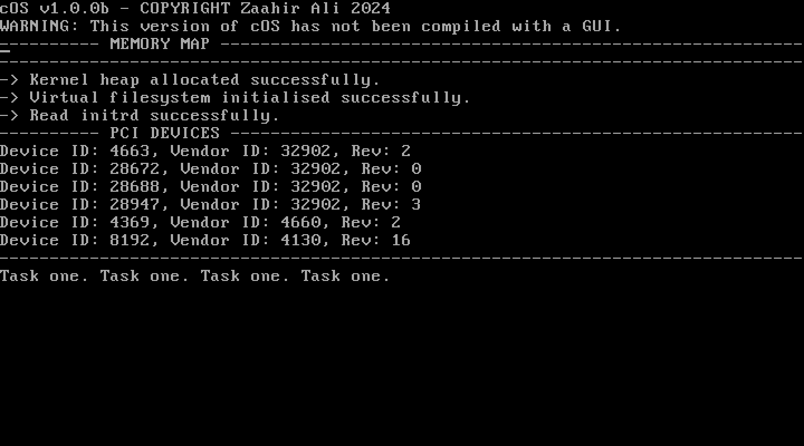
</p>

<p align="center">
<i>Screenshot of QEMU as evidence for test 1.1.</i>
</p>


<p align="center">
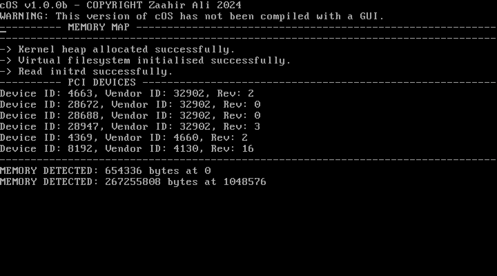
</p>

<p align="center">
<i>Screenshot of memory map as evidence for test 1.2. </i>
</p>

```cpp
for (auto it = Multiboot::MultibootManager::instance().first(MULTIBOOT_TAG_TYPE_MMAP); !it.is_end(); ++it)
{
    auto tag = reinterpret_cast<multiboot_tag_mmap*>(&(*it));
    for (auto entry = tag->entries;
        reinterpret_cast<uint64_t>(entry) < reinterpret_cast<uint64_t>(tag) + tag->size;
        entry = reinterpret_cast<multiboot_mmap_entry*>((reinterpret_cast<uint64_t>(entry) + tag->entry_size)))
    {
        if (entry->type != 1) { continue; }
        printf("MEMORY DETECTED: ");
        printf(entry->len);
        printf(" bytes at ");
        printf(entry->addr);
        printf("\n");
    }
}
```

<p align="center">
<i>Kernel code used to print the available memory regions for test 1.2. </i>
</p>


<p align="center">
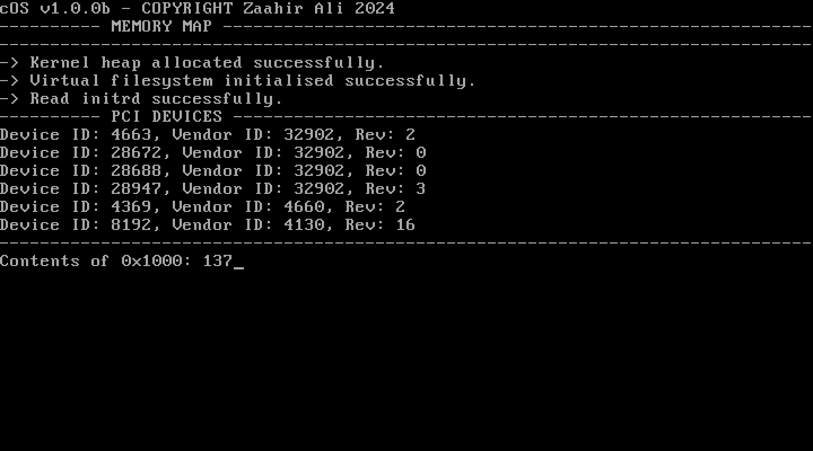
</p>

<p align="center">
<i>Screenshot of accessing the virtual address of the physical address 0x1000 as evidence for test 1.3.  </i>
</p>

```
(qemu) xp /1xb 0x1000
00001000: 0x89
```

<p align="center">
<i>QEMU monitor output of the contents of 0x1000 as evidence for test 1.3. <br>
    The xp command returns the content of a physical address.  </i>
</p>

```c
printf("Contents of 0x1000: "); 
printf(*(uint8_t*)Memory::VirtualAddress(Memory::PhysicalAddress(0x1000)).get()); 
```

<p align="center">
<i>Kernel code used to access address for test 1.3.   </i>
</p>


```
(qemu) info registers
...
CS =0008 0000000000000000 ffffffff 00af9a00 DPL=0 CS64 [-R-]
SS =0000 0000000000000000 ffffffff 00c09300 DPL=0 DS   [-WA]
TR =0030 ffffff800012e000 00000068 00008900 DPL=0 TSS64-avl
GDT=     ffffff800012e068 0000003f
IDT=     ffffff800012f060 00000fff
```

<p align="center">
<i>QEMU monitor registers for test 1.4. </i>
</p>


<p align="center">
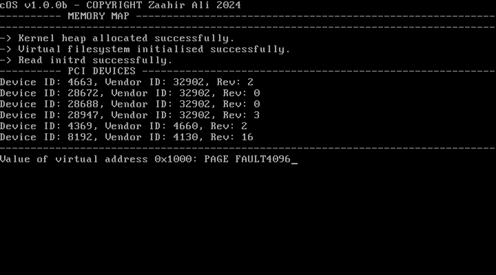
</p>

<p align="center">
<i>Screenshot of page fault before allocating page for test 1.5.  </i>
</p>

```c
printf("Value of virtual address 0x1000"); 
printf(*(uint8_t*)0x1000); 
```


<p align="center">
<i>Kernel code used to access address and cause page fault for test 1.5.  </i>
</p>

<p align="center">
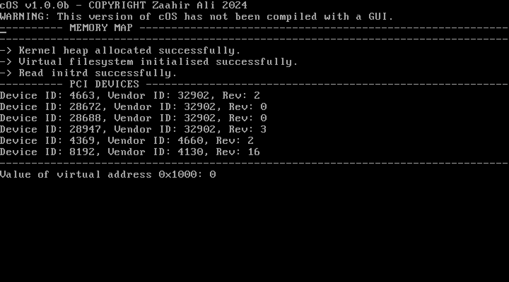
</p>

<p align="center">
<i>Screenshot of no page fault occurring after allocating page for test 1.5. </i>
</p>

```cpp
Memory::VirtualMemoryAllocationRequest request(Memory::VirtualAddress(0x1000), true, true); 
Memory::MemoryManager::instance().alloc_page(request); 

printf("Value of virtual address 0x1000: "); 

printf(*(uint8_t*)0x1000); 
```

<p align="center">
<i>Kernel code used to allocate page for test 1.5.   </i>
</p>


```
(qemu) info registers
...
GDT=     ffffff800012e068 0000003f
IDT=     ffffff800012f060 00000fff
CR0=80000011 CR2=0000000000000000 CR3=0000000000145000 CR4=00000020
```

<p align="center">
<i>QEMU monitor registers for test 1.6. </i>
</p>

```
(qemu) info pic
...
pic1: irr=00 imr=f7 isr=00 hprio=0 irq_base=28 rr_sel=0 elcr=0c fnm=0
pic0: irr=00 imr=f8 isr=00 hprio=0 irq_base=20 rr_sel=0 elcr=00 fnm=0
```

<p align="center">
<i>QEMU monitor PIC offsets for test 1.7. </i>
</p>

<p align="center">
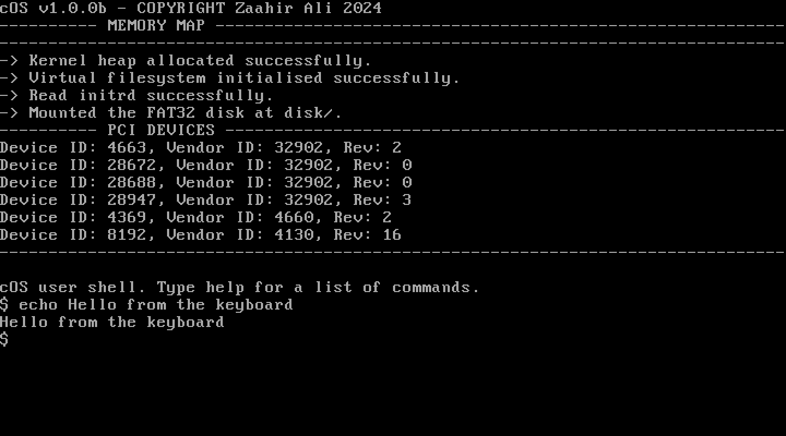
</p>

<p align="center">
<i>Screenshot of characters typed into the shell for test 1.8. </i>
</p>

<p align="center">
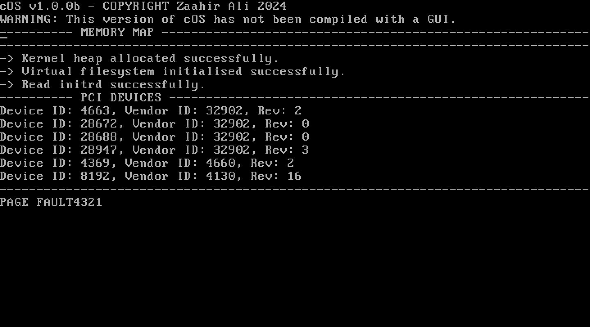
</p>

<p align="center">
<i>Screenshot of page fault occurring by accessing address 4321 for test 1.9. </i>
</p>

```cpp
printf(*(uint8_t*) 4321); 
```

<p align="center">
<i>Kernel code used to access address for test 1.9.  </i>
</p>

<p align="center">
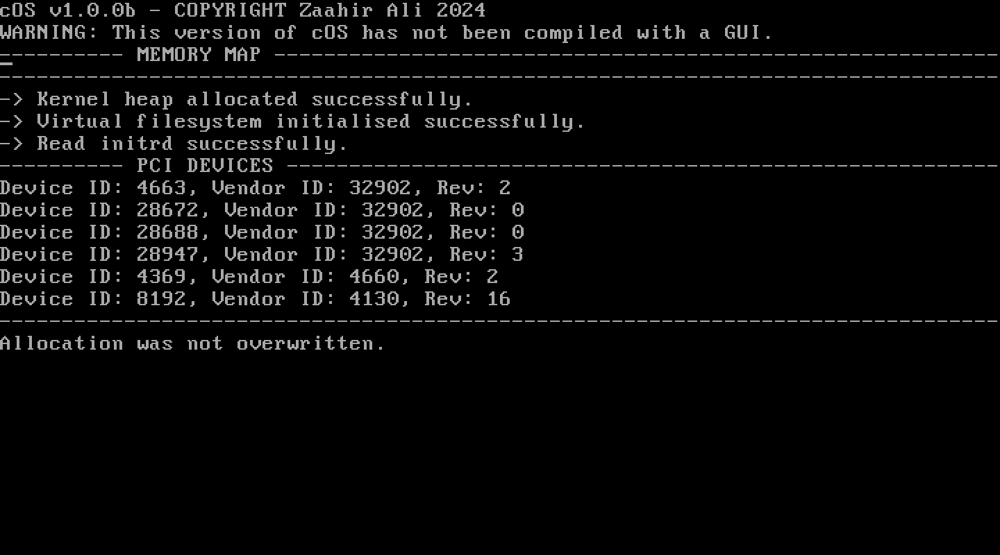
</p>

<p align="center">
<i>Screenshot of allocation not being overwritten for test 2.1.  </i>
</p>

```cpp
// Allocate 10 bytes. 
    auto allocation = kmalloc(10, 0); 
    uint8_t magicBytes[10] = {0x03, 0x11, 0x3F, 0x5C, 0x91, 0x11, 0x44, 0x53, 0xDE, 0xB0}; 
    // Copy magicBytes into allocation. 
    memcpy(allocation, magicBytes, 10); 
    // Allocate more bytes. 
    auto secondAllocation = kmalloc(100, 0); 
    kfree(secondAllocation); 
    // Check first allocation has not been overwritten. 
    bool overwritten = false; 
    for (int i = 0; i < 10; i++) 
    { 
        if (static_cast<uint8_t*>(allocation)[i] != magicBytes[i]) 
        { 
            overwritten = true; 
            break; 
        } 
    } 
    if (!overwritten) 
        printf("Allocation was not overwritten."); 
```

<p align="center">
<i>Kernel code used to allocate memory for test 2.1. </i>
</p>

<p align="center">
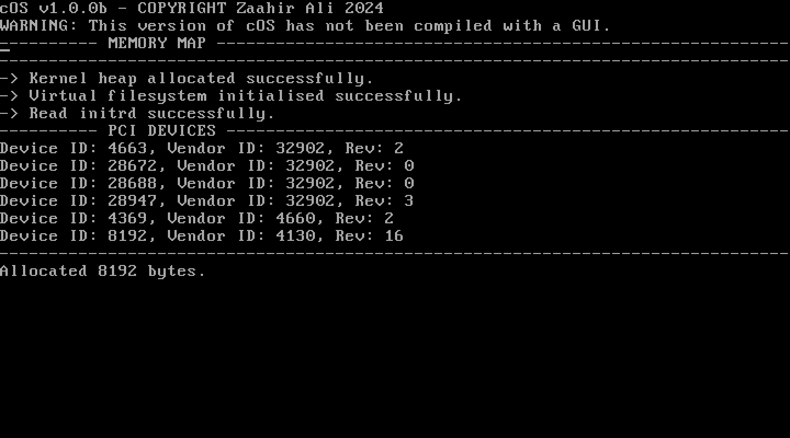
</p>

<p align="center">
<i>Screenshot of kernel not crashing for test 2.2. </i>
</p>

```cpp
// Allocate 8192 bytes. 
auto allocation = kmalloc(8192, 0); 
printf("Allocated 8192 bytes.");
```

<p align="center">
<i>Kernel code used to allocate memory for test 2.2. </i>
</p>

<p align="center">
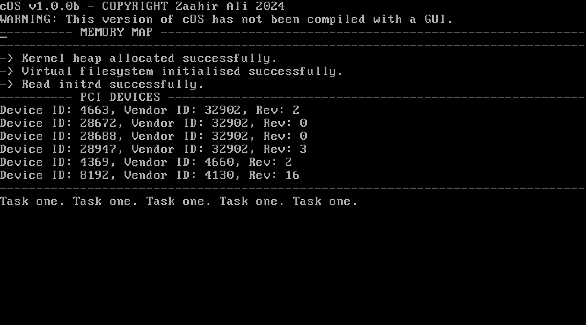
</p>

<p align="center">
<i>Screenshot of detected PCI devices for test 2.3. </i>
</p>


```
(qemu) info pci
  Bus  0, device   0, function 0:
    Host bridge: PCI device 8086:1237
      PCI subsystem 1af4:1100
      id ""
  Bus  0, device   1, function 0:
    ISA bridge: PCI device 8086:7000
      PCI subsystem 1af4:1100
      id ""
  Bus  0, device   1, function 1:
    IDE controller: PCI device 8086:7010
      PCI subsystem 1af4:1100
      BAR4: I/O at 0xc020 [0xc02f]
      id ""
  Bus  0, device   1, function 3:
    Bridge: PCI device 8086:7113
      PCI subsystem 1af4:1100
      IRQ 9, pin A
      id ""
  Bus  0, device   2, function 0:
    VGA controller: PCI device 1234:1111
      PCI subsystem 1af4:1100
      BAR0: 32 bit prefetchable memory at 0xfd000000 [0xfdffffff]
      BAR2: 32 bit memory at 0xfebd0000 [0xfebd0fff]
      BAR6: 32 bit memory (not mapped)
      id ""
  Bus  0, device   3, function 0:
    Ethernet controller: PCI device 1022:2000
      PCI subsystem 0000:0000
      IRQ 11, pin A
      BAR0: I/O at 0xc000 [0xc01f]
      BAR1: 32 bit memory (not mapped)
      BAR6: 32 bit memory (not mapped)
      id ""
```

<p align="center">
<i>QEMU monitor dump of emulated PCI devices for test 2.3. </i>
</p>

<p align="center">
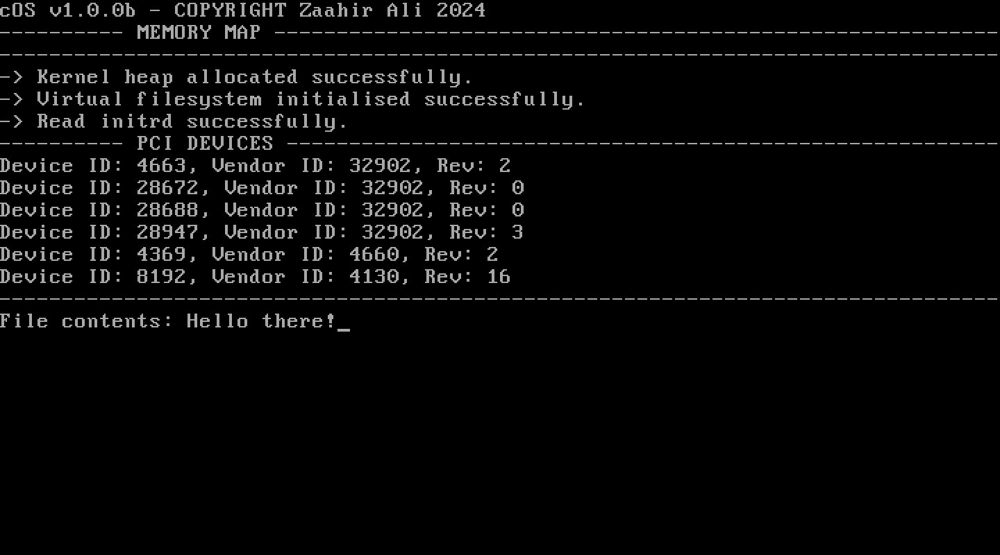
</p>

<p align="center">
<i>Screenshot of reading initrd/afile.txt for test 2.4.  </i>
</p>

```
Hello there!
```

<p align="center">
<i>Contents of initrd/afile.txt  </i>
</p>

```cpp
auto file = Filesystem::VirtualFilesystemManager::instance().open_file("initrd/afile.txt", 0); 
    auto fileLength = Filesystem::VirtualFilesystemManager::instance().filelen(file); 
    // Allocate a buffer to copy the contents of the file into. 
    // We add one to the length to add a null terminator. 
    auto fileBuffer = (char*) kmalloc(fileLength + 1, 0); 
    Filesystem::VirtualFilesystemManager::instance().read(file, 0, fileLength, fileBuffer); 
    // Add null terminator to string. 
    fileBuffer[fileLength] = '\0'; 
    printf("File contents: "); 
    printf(fileBuffer);
```

<p align="center">
<i>Kernel code used to read file for test 2.4. </i>
</p>

<p align="center">
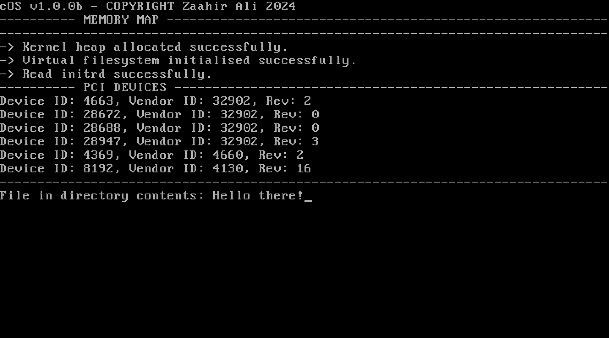
</p>

<p align="center">
<i>Screenshot of reading initrd/dir/afile.txt for test 2.5. </i>
</p>

```cpp
auto file = Filesystem::VirtualFilesystemManager::instance().open_file("initrd/dir/afile.txt", 0); 
    auto fileLength = Filesystem::VirtualFilesystemManager::instance().filelen(file); 
    // Allocate a buffer to copy the contents of the file into. 
    // We add one to the length to add a null terminator. 
    auto fileBuffer = (char*) kmalloc(fileLength + 1, 0); 
    Filesystem::VirtualFilesystemManager::instance().read(file, 0, fileLength, fileBuffer); 
    // Add null terminator to string. 
    fileBuffer[fileLength] = '\0'; 
    printf("File in directory contents: "); 
    printf(fileBuffer);
```

<p align="center">
<i>Kernel code used to read file for test 2.5.  </i>
</p>

<p align="center">
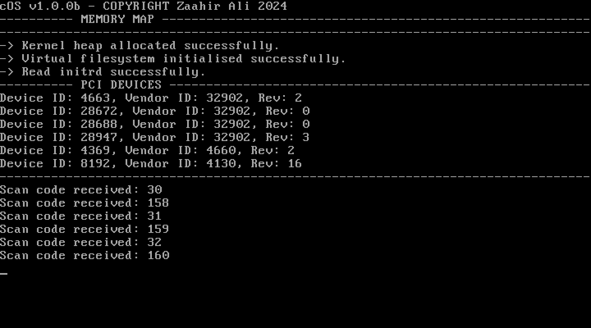
</p>

<p align="center">
<i>Screenshot of receiving keyboard events for test 2.6. </i>
</p>

```cpp
auto eventDescriptor = Events::EventDispatcher::instance().register_event_listener(Task::TaskManager::instance().get_current_task(), "HID/Keyboard", 0); 
    while (1) 
    { 
        Events::EventDispatcher::instance().block_event_listen(Task::TaskManager::instance().get_current_task(), eventDescriptor); 
        auto scanCode = (uint8_t)Events::EventDispatcher::instance().read_from_event_queue(Task::TaskManager::instance().get_current_task(), eventDescriptor); 
        printf("Scan code received: "); 
        printf(scanCode); 
        printf("\n");
    }
```

<p align="center">
<i>Kernel code used to receive keyboard events for test 2.6.</i>
</p>

<p align="center">
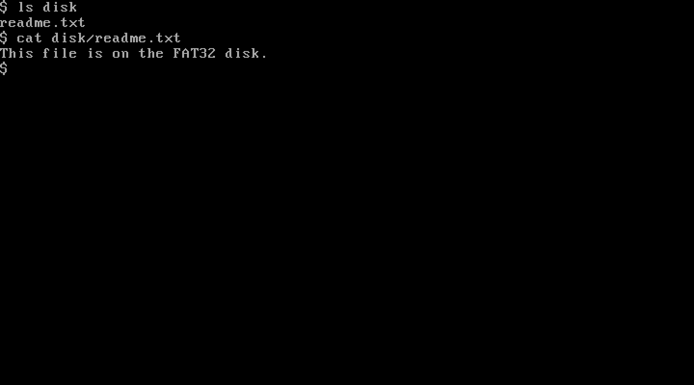
</p>

<p align="center">
<i>Screenshot of listing and reading the FAT32 disk for test 2.7. </i>
</p>

<p align="center">
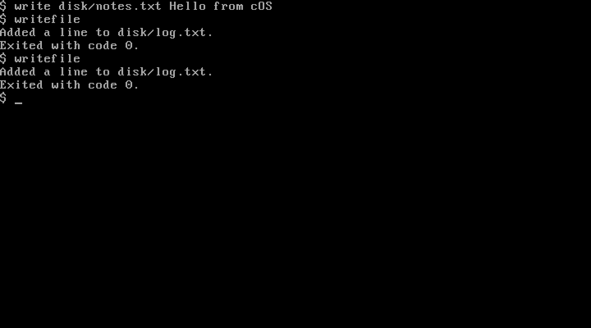
</p>

<p align="center">
<i>Screenshot of writing to files on the disk from the shell and a user-space program for test 2.8. </i>
</p>

<p align="center">
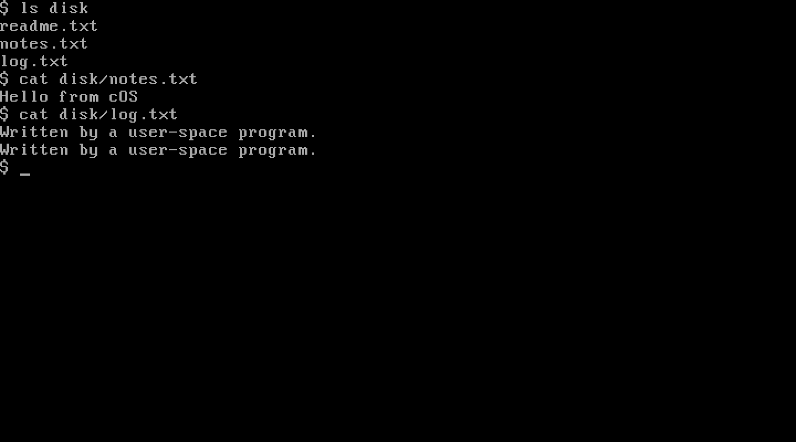
</p>

<p align="center">
<i>Screenshot of reading the files again after restarting for test 2.8. </i>
</p>

```
$ mtype -i build/disk.img ::notes.txt ::log.txt
Hello from cOS
Written by a user-space program.
Written by a user-space program.
```

<p align="center">
<i>Reading the same files on the host with mtools for test 2.8. </i>
</p>

```cpp
#include "process/syscall.h"

// Adds a line to a file on the disk with the file system calls, creating the file if it does not exist.
extern "C" void _start()
{
    const char line[] = "Written by a user-space program.\n";
    uint64_t fd = syscall(SYSCALL_FOPEN, (uint64_t)"disk/log.txt", FILE_CREATE | FILE_APPEND);
    if (fd == (uint64_t)-1)
    {
        syscall(SYSCALL_DPRINTF, (uint64_t)"Could not open disk/log.txt.\n");
        syscall(SYSCALL_EXIT, 1);
    }
    syscall(SYSCALL_FWRITE, fd, (uint64_t)line, sizeof(line) - 1);
    syscall(SYSCALL_FCLOSE, fd);
    syscall(SYSCALL_DPRINTF, (uint64_t)"Added a line to disk/log.txt.\n");
    syscall(SYSCALL_EXIT, 0);
}
```

<p align="center">
<i>ELF executable source code in <code>userspace/writefile.cpp</code> for test 2.8. </i>
</p>

```
1   0.000000 6e:65:74:77:6f:72 → 48:65:6c:6c:6f:20 0x6b21 14 Ethernet II

0000  48 65 6c 6c 6f 20 6e 65 74 77 6f 72 6b 21         Hello network!
```

<p align="center">
<i>Wireshark (tshark) output showing "Hello network!"<br>
  transmitted on the network for test 3.1.  </i>
</p>


```cpp
AMDPCNETIIIDriver.send_data((uint8_t*)"Hello network!", 14); 
```

<p align="center">
<i>Kernel code used to transmit on network for test 3.1. </i>
</p>


```
Frame 1: Packet, 28 bytes on wire (224 bits), 28 bytes captured (224 bits)
Ethernet II, Src: 52:54:00:12:34:56 (52:54:00:12:34:56), Dst: Broadcast (ff:ff:ff:ff:ff:ff)
    Destination: Broadcast (ff:ff:ff:ff:ff:ff)
    Source: 52:54:00:12:34:56 (52:54:00:12:34:56)
    Type: Unknown (0x0000)
Data (14 bytes)
0000  48 65 6c 6c 6f 20 6e 65 74 77 6f 72 6b 21         Hello network!
    Data: 48656c6c6f206e6574776f726b21
    [Length: 14]
```

<p align="center">
<i>Wireshark (tshark) output showing a compliant Ethernet II frame with the payload<br>
  "Hello network!" transmitted on the network for test 3.2.  </i>
</p>

```cpp
// The MAC destination is set to 0xFFFFFFFFFFFF for a broadcast message. 
Networking::Ethernet::EthernetLayerManager::instance()->send_data(0xFFFFFFFFFFFF, 0, (uint8_t*)"Hello network!", 14); 
```

<p align="center">
<i>Kernel code used to transmit Ethernet II frame on network for test 3.2. </i>
</p>

<p align="center">
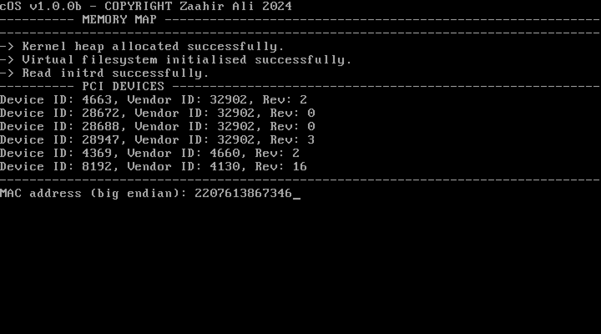
</p>

<p align="center">
<i>Screenshot of getting the MAC address for the gateway IP 10.0.2.2 for test 3.3. </i>
</p>

```
1   0.000000 52:54:00:12:34:56 → Broadcast    ARP 42 Who has 10.0.2.2? Tell 10.0.2.15
2   0.000024 52:55:0a:00:02:02 → 52:54:00:12:34:56 ARP 64 10.0.2.2 is at 52:55:0a:00:02:02

Address Resolution Protocol (reply)
    Hardware type: Ethernet (1)
    Protocol type: IPv4 (0x0800)
    Hardware size: 6
    Protocol size: 4
    Opcode: reply (2)
    Sender MAC address: 52:55:0a:00:02:02 (52:55:0a:00:02:02)
    Sender IP address: 10.0.2.2
    Target MAC address: 52:54:00:12:34:56 (52:54:00:12:34:56)
    Target IP address: 10.0.2.15
```

<p align="center">
<i>Wireshark (tshark) output showing compliant ARP request sent by the kernel and a<br> response which is processed and cached for test 3.3.  </i>
</p>

```cpp
// Gateway IP. 

uint8_t gip1 = 10, gip2 = 0, gip3 = 2, gip4 = 2; 

// Gateway IP big endian. 

uint32_t gip_be = ((uint32_t)gip4 << 24) 

                | ((uint32_t)gip3 << 16) 

                | ((uint32_t)gip2 << 8) 

                | (uint32_t)gip1;
                uint64_t MACAddress = 0; 

Networking::AddressResolutionProtocol::AddressResolutionProtocolManager::instance()->send_ARP_request(gip_be); 

while (!MACAddress) 

{ 

    MACAddress = Networking::AddressResolutionProtocol::AddressResolutionProtocolManager::instance()->find_cached_IP_address(gip_be); 

} 

printf("MAC address (big endian): "); 

printf(MACAddress); 
```

<p align="center">
<i>Kernel code used to resolve gateway IP address using ARP for test 3.3. </i>
</p>

```
1   0.000000 52:54:00:12:34:56 → Broadcast    ARP 42 Who has 10.0.2.2? Tell 10.0.2.15
2   0.000974 52:55:0a:00:02:02 → 52:54:00:12:34:56 ARP 64 10.0.2.2 is at 52:55:0a:00:02:02
3   0.007759    10.0.2.15 → 10.0.2.2     IPv4 48 IPv6 hop-by-hop options[Malformed Packet]

Internet Protocol Version 4, Src: 10.0.2.15, Dst: 10.0.2.2
    0100 .... = Version: 4
    .... 0101 = Header Length: 20 bytes (5)
    Differentiated Services Field: 0x2f (DSCP: Unknown, ECN: CE)
    Total Length: 34
    Identification: 0x0001 (1)
    010. .... = Flags: 0x2, Don't fragment
        .1.. .... = Don't fragment: Set
    ...0 0000 0000 0000 = Fragment Offset: 0
    Time to Live: 64
    Protocol: IPv6 Hop-by-Hop Option (0)
    Header Checksum: 0x229c [validation disabled]
    [Header checksum status: Unverified]
    Source Address: 10.0.2.15
    Destination Address: 10.0.2.2
IPv6 Hop-by-Hop Option
[Malformed Packet: IPv6 Hop-by-Hop]
```

<p align="center">
<i>Wireshark (tshark) output showing a compliant IPv4 packet transmitted <br> (other than protocol type) for test 3.4. </i>
</p>

```cpp
uint8_t gip1 = 10, gip2 = 0, gip3 = 2, gip4 = 2; 

uint32_t gip_be = ((uint32_t)gip4 << 24) 

                | ((uint32_t)gip3 << 16) 

                | ((uint32_t)gip2 << 8) 

                | (uint32_t)gip1; 

Networking::InternetProtocolV4::InternetProtocolManager::instance()->send_data(gip_be, 0x0, (uint8_t*)"Hello network!", 14); 
```

<p align="center">
<i>Kernel code used to send IPv4 packet for test 3.4. </i>
</p>

```
1   0.000000 52:54:00:12:34:56 → Broadcast    ARP 42 Who has 10.0.2.2? Tell 10.0.2.15
2   0.000017 52:55:0a:00:02:02 → 52:54:00:12:34:56 ARP 64 10.0.2.2 is at 52:55:0a:00:02:02
3   0.007515    10.0.2.15 → 10.0.2.2     UDP 56 1024 → 1234 Len=14

User Datagram Protocol, Src Port: 1024, Dst Port: 1234
    Source Port: 1024
    Destination Port: 1234
    Length: 22
    Checksum: 0x0000 [zero-value ignored]
        [Checksum Status: Not present]
    UDP payload (14 bytes)
Data (14 bytes)
0000  48 65 6c 6c 6f 20 6e 65 74 77 6f 72 6b 21         Hello network!
    Data: 48656c6c6f206e6574776f726b21
    [Length: 14]
```

<p align="center">
<i>Wireshark (tshark) output showing a compliant UDP packet transmitted for test 3.5.  </i>
</p>

```cpp
uint8_t gip1 = 10, gip2 = 0, gip3 = 2, gip4 = 2; 

uint32_t gip_be = ((uint32_t)gip4 << 24) 

                | ((uint32_t)gip3 << 16) 

                | ((uint32_t)gip2 << 8) 

                | (uint32_t)gip1; 

auto udpManager = new Networking::UserDatagramProtocol::UserDatagramProtocolManager(); 
auto socket = udpManager->connect(gip_be, 1234); 

udpManager->send(socket, (uint8_t*)"Hello network!", 14); 
```

<p align="center">
<i>Kernel code used to transmit UDP packet for test 3.5.  </i>
</p>

```
1   0.000000 52:55:0a:00:02:02 → Broadcast    ARP 60 Who has 10.0.2.15? Tell 10.0.2.2
2   0.002879 52:54:00:12:34:56 → 52:55:0a:00:02:02 ARP 42 10.0.2.15 is at 52:54:00:12:34:56
3   0.003016     10.0.2.2 → 10.0.2.15    UDP 60 62081 → 1234 Len=16

User Datagram Protocol, Src Port: 62081, Dst Port: 1234
    Source Port: 62081
    Destination Port: 1234
    Length: 24
    Checksum: 0xf28a [unverified]
    [Checksum Status: Unverified]
    UDP payload (16 bytes)
Data (16 bytes)
0000  48 65 6c 6c 6f 20 66 72 6f 6d 20 68 6f 73 74 21   Hello from host!
    Data: 48656c6c6f2066726f6d20686f737421
    [Length: 16]
```

<p align="center">
<i>Wireshark (tshark) output showing a compliant UDP packet being received for test 3.6.   </i>
</p>

<p align="center">

</p>

<p align="center">
<i>Screenshot of the kernel printing the data received over UDP, sent from the host with <code>nc -u</code>, for test 3.6. </i>
</p>

```cpp
auto udpManager = new Networking::UserDatagramProtocol::UserDatagramProtocolManager(); 
auto socket = udpManager->listen(1234); 
```

<p align="center">
<i>Kernel code used to receive UDP packet for test 3.6.  </i>
</p>

```
1   0.000000 52:54:00:12:34:56 → Broadcast    ARP 42 Who has 10.0.2.2? Tell 10.0.2.15
2   0.000046 52:55:0a:00:02:02 → 52:54:00:12:34:56 ARP 64 10.0.2.2 is at 52:55:0a:00:02:02
3   0.008314    10.0.2.15 → 10.0.2.2     TCP 58 1024 → 1234 [SYN] Seq=0 Win=8192 Len=0 MSS=1460
4   0.008638     10.0.2.2 → 10.0.2.15    TCP 60 1234 → 1024 [SYN, ACK] Seq=0 Ack=1 Win=65535 Len=0 MSS=1460
5   0.018228    10.0.2.15 → 10.0.2.2     TCP 58 1024 → 1234 [ACK] Seq=1 Ack=1 Win=8192 Len=0
6   0.018547    10.0.2.15 → 10.0.2.2     TCP 72 1024 → 1234 [ACK] Seq=1 Ack=1 Win=8192 Len=14
7   0.018598     10.0.2.2 → 10.0.2.15    TCP 60 1234 → 1024 [ACK] Seq=1 Ack=15 Win=65535 Len=0
8   8.022046     10.0.2.2 → 10.0.2.15    TCP 60 1234 → 1024 [FIN, ACK] Seq=1 Ack=15 Win=65535 Len=0
9   8.022585    10.0.2.15 → 10.0.2.2     TCP 58 1024 → 1234 [ACK] Seq=15 Ack=2 Win=8192 Len=0
```

<p align="center">
<i>Wireshark (tshark) output showing a compliant TCP connection when connecting<br> to a remote endpoint for test 3.7. </i>
</p>


```cpp
uint8_t gip1 = 10, gip2 = 0, gip3 = 2, gip4 = 2; 

uint32_t gip_be = ((uint32_t)gip4 << 24) 

                | ((uint32_t)gip3 << 16) 

                | ((uint32_t)gip2 << 8) 

                | (uint32_t)gip1; 

auto tcpManager = new Networking::TransmissionControlProtocol::TransmissionControlProtocolManager(); 
auto socket = tcpManager->connect(gip_be, 1234); 

while (socket->m_state != Networking::TransmissionControlProtocol::TransmissionControlProtocolSocket::State::ESTABLISHED) {} 

socket->send((uint8_t*)"Hello network!", 14); 
```

<p align="center">
<i>Kernel code used to connect to a remote TCP endpoint for test 3.7. </i>
</p>

```
1   0.000000 52:54:00:12:34:56 → Broadcast    ARP 42 Who has 10.0.2.2? Tell 10.0.2.15
2   0.000021 52:55:0a:00:02:02 → 52:54:00:12:34:56 ARP 64 10.0.2.2 is at 52:55:0a:00:02:02
3   0.007673    10.0.2.15 → 10.0.2.2     TCP 58 1024 → 3939 [SYN] Seq=0 Win=8192 Len=0 MSS=1460
4   0.007991     10.0.2.2 → 10.0.2.15    TCP 60 3939 → 1024 [SYN, ACK] Seq=0 Ack=1 Win=65535 Len=0 MSS=1460
5   0.017825    10.0.2.15 → 10.0.2.2     TCP 58 1024 → 3939 [ACK] Seq=1 Ack=1 Win=8192 Len=0
6   0.018079    10.0.2.15 → 10.0.2.2     HTTP/JSON 217 POST /d493159e-39a2-4015-a5b7-cfcc05a9d739 HTTP/1.1 , JSON (application/json)
7   0.018115     10.0.2.2 → 10.0.2.15    TCP 60 3939 → 1024 [ACK] Seq=1 Ack=160 Win=65535 Len=0
8   0.028448     10.0.2.2 → 10.0.2.15    HTTP 206 HTTP/1.0 200 OK  (text/html)
9   0.028480     10.0.2.2 → 10.0.2.15    TCP 60 3939 → 1024 [FIN, ACK] Seq=153 Ack=160 Win=65535 Len=0
10   0.029511    10.0.2.15 → 10.0.2.2     TCP 58 1024 → 3939 [ACK] Seq=160 Ack=153 Win=8192 Len=0
11   0.029785    10.0.2.15 → 10.0.2.2     TCP 58 1024 → 3939 [ACK] Seq=160 Ack=154 Win=8192 Len=0

Hypertext Transfer Protocol
    POST /d493159e-39a2-4015-a5b7-cfcc05a9d739 HTTP/1.1\n
        Request Method: POST
        Request URI: /d493159e-39a2-4015-a5b7-cfcc05a9d739
        Request Version: HTTP/1.1
    Host: localhost\n
    Accept: application/json\n
    Content-Type: application/json\n
    Content-Length: 15\n
        [Content length: 15]
    \n
    [Full request URI: http://localhost/d493159e-39a2-4015-a5b7-cfcc05a9d739]
    File Data: 15 bytes
JavaScript Object Notation: application/json
```

<p align="center">
<i>Wireshark (tshark) output showing a compliant HTTP POST request sent for test 3.8.  </i>
</p>

```cpp
uint8_t gip1 = 10, gip2 = 0, gip3 = 2, gip4 = 2; 

uint32_t gip_be = ((uint32_t)gip4 << 24) 

                | ((uint32_t)gip3 << 16) 

                | ((uint32_t)gip2 << 8) 

                | (uint32_t)gip1; 

auto tcpManager = new Networking::TransmissionControlProtocol::TransmissionControlProtocolManager(); 
auto socket = tcpManager->connect(gip_be, 3939); 
while (socket->m_state != Networking::TransmissionControlProtocol::TransmissionControlProtocolSocket::State::ESTABLISHED) {} 
socket->send((uint8_t*)"POST /d493159e-39a2-4015-a5b7-cfcc05a9d739 HTTP/1.1\nHost: localhost\nAccept: application/json\nContent-Type: application/json\nContent-Length: 15\n\n{\"test\":\"data\"}", 159); 
```

<p align="center">
<i>Kernel code used to connect to a remote TCP endpoint for test 3.8.   </i>
</p>

<p align="center">
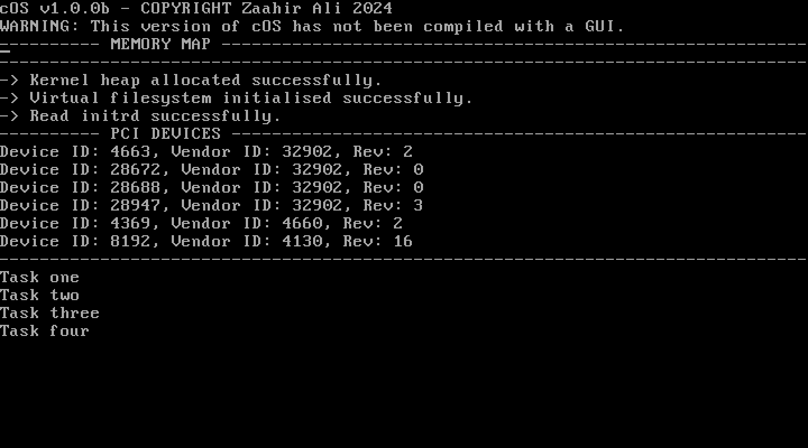
</p>

<p align="center">
<i>Screenshot of kernel running multiple tasks for test 4.1.  </i>
</p>

```cpp
void task_one() 
{ 
    printf("Task one\n"); 
    while (1); 
} 

void task_two() 
{ 
    printf("Task two\n"); 
    while (1); 
} 

void task_three() 
{ 
    printf("Task three\n"); 
    while (1); 
} 

void task_four() 
{ 
    printf("Task four\n"); 
    while (1); 
} 

auto task1 = Task::TaskManager::instance().create_new_kernel_task(); 
task1.set_entry_point((void*)& task_one); 
auto task2 = Task::TaskManager::instance().create_new_kernel_task(); 
task2.set_entry_point((void*)& task_two); 
auto task3 = Task::TaskManager::instance().create_new_kernel_task(); 
task3.set_entry_point((void*)& task_three); 
auto task4 = Task::TaskManager::instance().create_new_kernel_task(); 
task4.set_entry_point((void*)& task_four); 

Task::TaskManager::instance().add_task(task1); 
Task::TaskManager::instance().add_task(task2); 
Task::TaskManager::instance().add_task(task3); 
Task::TaskManager::instance().add_task(task4); 
Task::TaskManager::instance().run();
```

<p align="center">
<i>Kernel code to run multiple tasks for test 4.1. </i>
</p>

<p align="center">
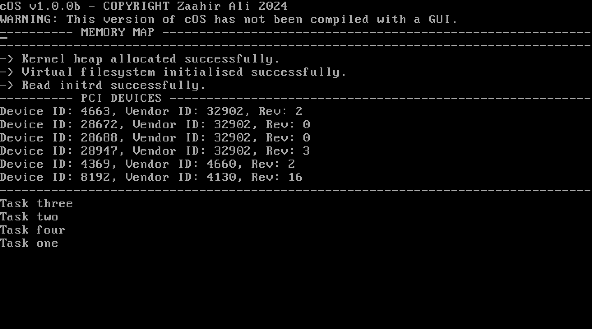
</p>

<p align="center">
<i>Screenshot of kernel running different priority tasks for test 4.2. </i>
</p>


```cpp
void task_one() 
{ 
    printf("Task one\n"); 
    while (1) 
        Task::TaskManager::instance().sleep_for(1000); 
}  

void task_two() 
{ 
    printf("Task two\n"); 
    while (1) 
        Task::TaskManager::instance().sleep_for(1000); 
} 


void task_three() 
{ 
    printf("Task three\n"); 
    while (1) 
        Task::TaskManager::instance().sleep_for(1000); 
} 

void task_four() 
{ 
    printf("Task four\n"); 
    while (1) 
        Task::TaskManager::instance().sleep_for(1000); 
} 


auto task1 = Task::TaskManager::instance().create_new_kernel_task(600); 
task1.set_entry_point((void*)& task_one); 
auto task2 = Task::TaskManager::instance().create_new_kernel_task(270); 
task2.set_entry_point((void*)& task_two); 
auto task3 = Task::TaskManager::instance().create_new_kernel_task(23); 
task3.set_entry_point((void*)& task_three); 
auto task4 = Task::TaskManager::instance().create_new_kernel_task(512); 
task4.set_entry_point((void*)& task_four); 

Task::TaskManager::instance().add_task(task1);
Task::TaskManager::instance().add_task(task2); 
Task::TaskManager::instance().add_task(task3); 
Task::TaskManager::instance().add_task(task4); 
Task::TaskManager::instance().run();
```

<p align="center">
<i>Kernel code to run multiple tasks for test 4.2.  </i>
</p>

<p align="center">
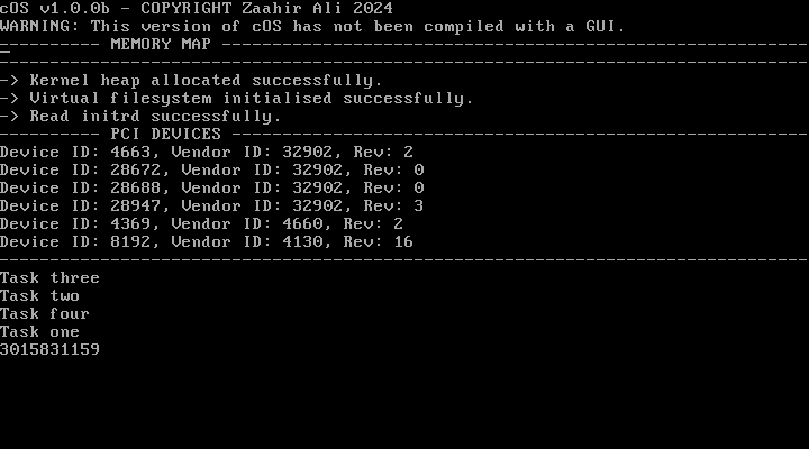
</p>

<p align="center">
<i>Screenshot of kernel receiving keyboard interrupts as all tasks block for test 4.3.  </i>
</p>

```cpp
void task_one() 
{ 
    printf("Task one\n"); 
    Task::TaskManager::instance().block_task(); 
} 

void task_two() 
{ 
    printf("Task two\n"); 
    Task::TaskManager::instance().block_task(); 
} 

void task_three() 
{ 
    printf("Task three\n"); 
    Task::TaskManager::instance().block_task(); 
} 

void task_four() 
{ 
    printf("Task four\n"); 
    Task::TaskManager::instance().block_task(); 
} 

auto task1 = Task::TaskManager::instance().create_new_kernel_task(600); 
task1.set_entry_point((void*)& task_one); 
auto task2 = Task::TaskManager::instance().create_new_kernel_task(270); 
task2.set_entry_point((void*)& task_two); 
auto task3 = Task::TaskManager::instance().create_new_kernel_task(23); 
task3.set_entry_point((void*)& task_three); 
auto task4 = Task::TaskManager::instance().create_new_kernel_task(512); 
task4.set_entry_point((void*)& task_four); 

Task::TaskManager::instance().add_task(task1); 
Task::TaskManager::instance().add_task(task2); 
Task::TaskManager::instance().add_task(task3); 
Task::TaskManager::instance().add_task(task4); 
Task::TaskManager::instance().run(); 
```

<p align="center">
<i>Kernel code to run multiple tasks for test 4.3.  </i>
</p>

<p align="center">

</p>

<p align="center">
<i>Screenshot of user-space program executing a system call for test 4.4.  </i>
</p>

```cpp
void elf_task() 
{ 
    Task::TaskManager::instance().lock(); 
    auto currentTask = Task::TaskManager::instance().get_current_task_pointer(); 
    Loader::prepare_elf("initrd/bin/hello", currentTask); 
    auto entryPoint = currentTask->get_entry_point(); 
    Task::TaskManager::instance().unlock(); 
    // prepare_elf maps a 16KiB user stack at 0x1000000, and the stack grows down from its top.
    start_userspace_task_sysret((uint64_t)entryPoint, 0x1000000 + Memory::PAGE_4KiB * 4); 

} 
```

<p align="center">
<i>Kernel code to load ELF executable and run in user-space for test 4.4. </i>
</p>

```cpp
#include "process/syscall.h"

// Prints a message using the system call interface.
extern "C" void _start()
{
    syscall(SYSCALL_DPRINTF, (uint64_t)"Hello from userspace!\n");
    syscall(SYSCALL_EXIT, 0);
}
```

<p align="center">
<i>ELF executable source code in <code>userspace/hello.cpp</code> for test 4.4. CMake compiles each program in <code>userspace</code> into <code>initrd/bin</code>. </i>
</p>

```cpp
extern "C" void _start() 
{ 
    asm volatile ("cli"); 
    while (1); 
}
```

<p align="center">
<i>ELF executable source code that causes General Protection<br> Fault for test 4.5.  </i>
</p>

```
v=0d e=0000 i=0 cpl=3 IP=002b:0000000000400104 pc=0000000000400104 SP=0023:0000000001003ff8
```

<p align="center">
<i>QEMU interrupt log (<code>-d int</code>) showing a General Protection Fault (vector 0x0d) raised at privilege level 3 by the <code>cli</code> instruction for test 4.5. </i>
</p>

<p align="center">
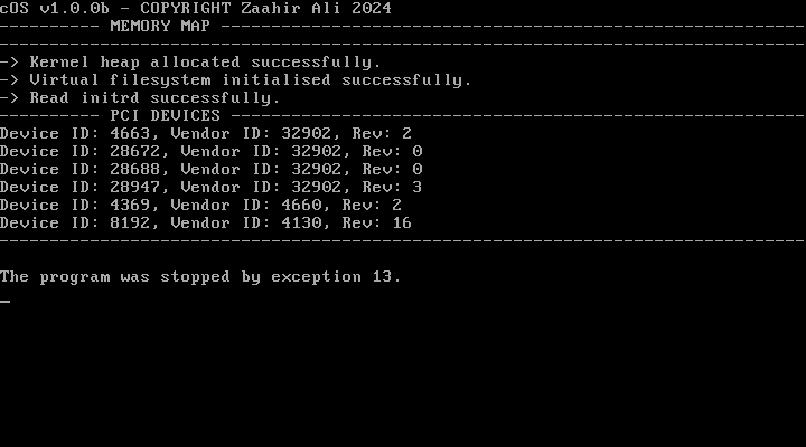
</p>

<p align="center">
<i>Screenshot of the kernel stopping the program after the General Protection Fault for test 4.5. </i>
</p>

```cpp
void task_one() 
{ 
    while (1) 
    { 
        printf("Task one. "); 
        Task::TaskManager::instance().sleep_for(1000); 
    } 
} 
```

<p align="center">
<i>Kernel code that prints to screen roughly every second for test 4.6.</i>
</p>

<p align="center">
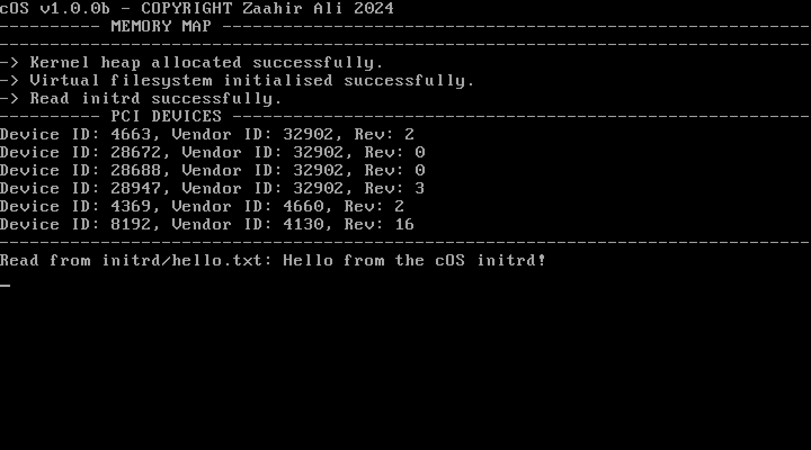
</p>

<p align="center">
<i>Screenshot of a user-space program reading a file for test 4.7. </i>
</p>

```cpp
#include "process/syscall.h"

// Reads a file from the initrd with the file system calls, and prints it.
extern "C" void _start()
{
    char buffer[64];
    uint64_t fd = syscall(SYSCALL_FOPEN, (uint64_t)"initrd/hello.txt", 0);
    uint64_t length = syscall(SYSCALL_FREAD, fd, (uint64_t)buffer, sizeof(buffer) - 1);
    buffer[length] = '\0';
    syscall(SYSCALL_FCLOSE, fd);

    syscall(SYSCALL_DPRINTF, (uint64_t)"Read from initrd/hello.txt: ");
    syscall(SYSCALL_DPRINTF, (uint64_t)buffer);
    // The exit code is the number of bytes read.
    syscall(SYSCALL_EXIT, length);
}
```

<p align="center">
<i>ELF executable source code in <code>userspace/readfile.cpp</code> for test 4.7, which is loaded with the kernel code from test 4.4. </i>
</p>

<p align="center">
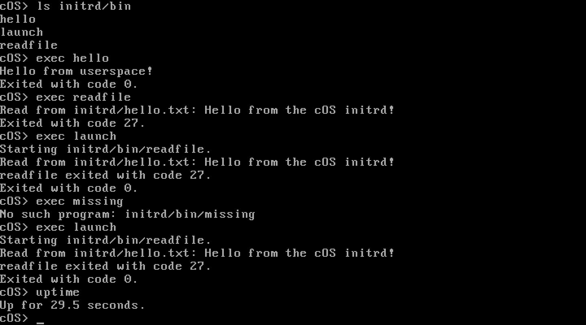
</p>

<p align="center">
<i>Screenshot of running user-space programs from the shell for test 4.8. </i>
</p>

```cpp
#include "process/syscall.h"

// Writes a number into a buffer as decimal digits.
void format_number(uint64_t number, char* buffer)
{
    char digits[21];
    uint64_t count = 0;
    do
    {
        digits[count++] = '0' + number % 10;
        number /= 10;
    }
    while (number);
    for (uint64_t i = 0; i < count; i++)
        buffer[i] = digits[count - 1 - i];
    buffer[count] = '\0';
}

// Starts another program, waits for it to exit, and prints its exit code.
extern "C" void _start()
{
    syscall(SYSCALL_DPRINTF, (uint64_t)"Starting initrd/bin/readfile.\n");
    uint64_t tid = syscall(SYSCALL_SPAWN, (uint64_t)"initrd/bin/readfile");
    uint64_t exitCode = syscall(SYSCALL_WAIT, tid);

    char number[21];
    format_number(exitCode, number);
    syscall(SYSCALL_DPRINTF, (uint64_t)"readfile exited with code ");
    syscall(SYSCALL_DPRINTF, (uint64_t)number);
    syscall(SYSCALL_DPRINTF, (uint64_t)".\n");
    syscall(SYSCALL_EXIT, 0);
}
```

<p align="center">
<i>ELF executable source code in <code>userspace/launch.cpp</code> for test 4.8, which starts <code>readfile</code> and waits for it to exit. </i>
</p>

```
cOS> mem
Free memory: 260372 KiB
cOS> exec memtest        (run ten times)
...
cOS> mem
Free memory: 260364 KiB
```

<p align="center">
<i>Free memory before and after running <code>memtest</code> ten times for test 4.8. Without reaping, the same ten runs leave 258632 KiB free. </i>
</p>

<p align="center">
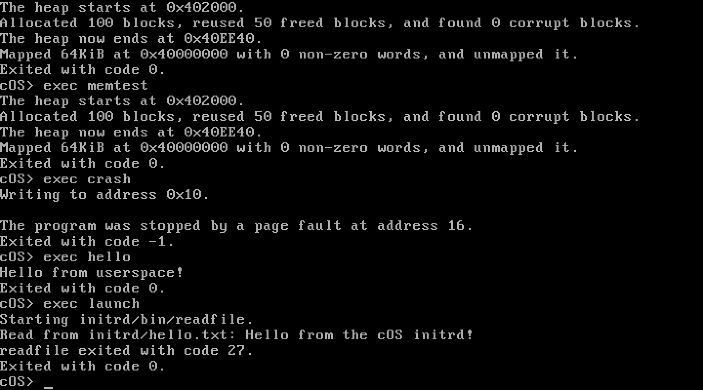
</p>

<p align="center">
<i>Screenshot of allocating memory and stopping a faulting program for test 4.9. </i>
</p>

```cpp
#include "process/syscall.h"
#include "output.h"
#include "malloc.h"

constexpr uint64_t BLOCK_COUNT = 100;

// Allocates and frees memory with malloc, which uses brk, and maps memory directly with mmap.
extern "C" void _start()
{
    print("The heap starts at ");
    print_number(syscall(SYSCALL_BRK, 0), 16);
    print(".\n");

    // Allocate blocks of different sizes, and fill each block with its own index.
    uint8_t* blocks[BLOCK_COUNT];
    for (uint64_t i = 0; i < BLOCK_COUNT; i++)
    {
        blocks[i] = (uint8_t*)malloc(i * 10 + 1);
        for (uint64_t j = 0; j < i * 10 + 1; j++) { blocks[i][j] = i; }
    }

    // Free every second block, and allocate again so that the freed blocks are reused.
    for (uint64_t i = 0; i < BLOCK_COUNT; i += 2) { free(blocks[i]); }
    uint64_t reusedCount = 0;
    for (uint64_t i = 0; i < BLOCK_COUNT; i += 2)
    {
        auto block = (uint8_t*)malloc(i * 10 + 1);
        if (block == blocks[i]) { reusedCount++; }
        for (uint64_t j = 0; j < i * 10 + 1; j++) { block[j] = i; }
        blocks[i] = block;
    }

    // Check that no block was overwritten by another.
    uint64_t corruptCount = 0;
    for (uint64_t i = 0; i < BLOCK_COUNT; i++)
    {
        for (uint64_t j = 0; j < i * 10 + 1; j++)
        {
            if (blocks[i][j] != i) { corruptCount++; break; }
        }
    }
    print("Allocated ");
    print_number(BLOCK_COUNT);
    print(" blocks, reused ");
    print_number(reusedCount);
    print(" freed blocks, and found ");
    print_number(corruptCount);
    print(" corrupt blocks.\n");
    print("The heap now ends at ");
    print_number(syscall(SYSCALL_BRK, 0), 16);
    print(".\n");

    // Map 64KiB with mmap, check that it starts as zeros, fill it, and unmap it.
    uint64_t length = 64 * 1024;
    auto mapped = (uint64_t*)syscall(SYSCALL_VMMAP, length);
    uint64_t nonZeroCount = 0;
    for (uint64_t i = 0; i < length / sizeof(uint64_t); i++)
    {
        if (mapped[i]) { nonZeroCount++; }
        mapped[i] = i;
    }
    print("Mapped 64KiB at ");
    print_number((uint64_t)mapped, 16);
    print(" with ");
    print_number(nonZeroCount);
    print(" non-zero words, and unmapped it.\n");
    syscall(SYSCALL_VMUNMAP, (uint64_t)mapped, length);
    syscall(SYSCALL_EXIT, corruptCount);
}
```

<p align="center">
<i>ELF executable source code in <code>userspace/memtest.cpp</code> for test 4.9. The allocator is in <code>userspace/include/malloc.h</code>. </i>
</p>

```cpp
#include "process/syscall.h"

// Writes to memory that the program does not own, which causes a page fault.
// The kernel stops the program, and the shell keeps running.
extern "C" void _start()
{
    syscall(SYSCALL_DPRINTF, (uint64_t)"Writing to address 0x10.\n");
    *(volatile uint64_t*)0x10 = 1;
    syscall(SYSCALL_DPRINTF, (uint64_t)"This line is never printed.\n");
    syscall(SYSCALL_EXIT, 0);
}
```

<p align="center">
<i>ELF executable source code in <code>userspace/crash.cpp</code> for test 4.9. </i>
</p>

<p align="center">
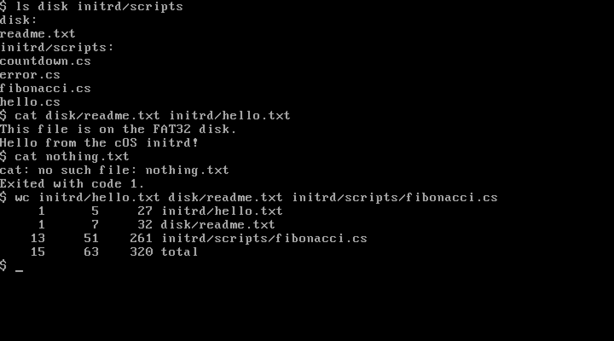
</p>

<p align="center">
<i>Screenshot of running ls, cat and wc with arguments for test 4.10. </i>
</p>

```
$ wc initrd/hello.txt disk/readme.txt initrd/scripts/fibonacci.cs
       1       5      27 initrd/hello.txt
       1       7      32 disk/readme.txt
      13      51     261 initrd/scripts/fibonacci.cs
      15      63     320 total
```

<p align="center">
<i>The host's <code>wc</code> on the same files for test 4.10. </i>
</p>

```cpp
#include "start.h"
#include "stdio.h"
#include "unistd.h"

// Counts the lines, words and bytes in each file named in the arguments, as the Unix wc program does.
int main(int argc, char** argv)
{
    if (argc < 2)
    {
        puts("Usage: wc <file>...");
        return 1;
    }
    uint64_t totalLines = 0;
    uint64_t totalWords = 0;
    uint64_t totalBytes = 0;
    for (int i = 1; i < argc; i++)
    {
        int64_t fd = open(argv[i]);
        if (fd < 0)
        {
            printf("wc: no such file: %s\n", argv[i]);
            return 1;
        }
        uint64_t lines = 0;
        uint64_t words = 0;
        uint64_t bytes = 0;
        bool isInWord = false;
        char buffer[256];
        int64_t length;
        while ((length = read(fd, buffer, sizeof(buffer))) > 0)
        {
            bytes += length;
            for (int64_t j = 0; j < length; j++)
            {
                char c = buffer[j];
                if (c == '\n') { lines++; }
                // A word starts at the first character that is not a space after a space.
                bool isSpace = c == ' ' || c == '\n' || c == '\t';
                if (!isSpace && !isInWord) { words++; }
                isInWord = !isSpace;
            }
        }
        close(fd);
        printf("%6lu %6lu %6lu %s\n", lines, words, bytes, argv[i]);
        totalLines += lines;
        totalWords += words;
        totalBytes += bytes;
    }
    if (argc > 2) { printf("%6lu %6lu %6lu total\n", totalLines, totalWords, totalBytes); }
    return 0;
}
```

<p align="center">
<i>ELF executable source code in <code>userspace/wc.cpp</code> for test 4.10. The C library headers, such as <code>stdio.h</code> with <code>printf</code>, are in <code>userspace/include</code>. </i>
</p>

<p align="center">
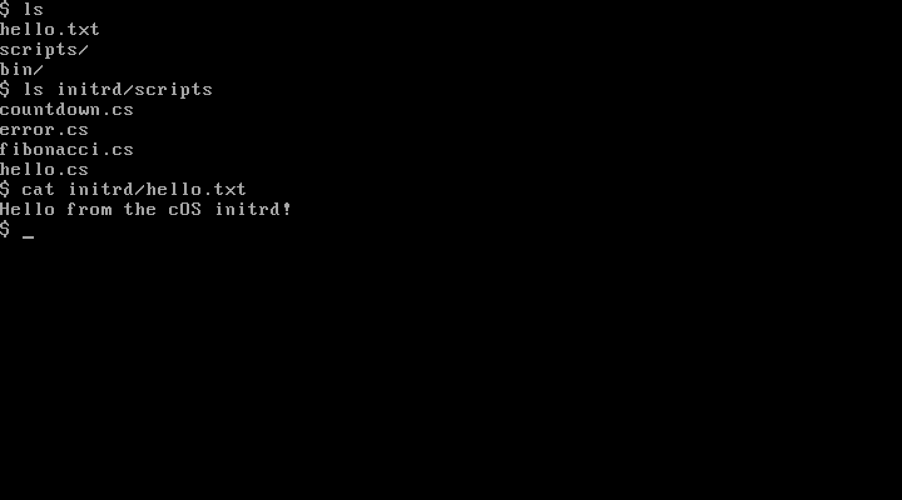
</p>

<p align="center">
<i>Screenshot of listing the initrd and printing a file in the shell for test 5.1. </i>
</p>

<p align="center">
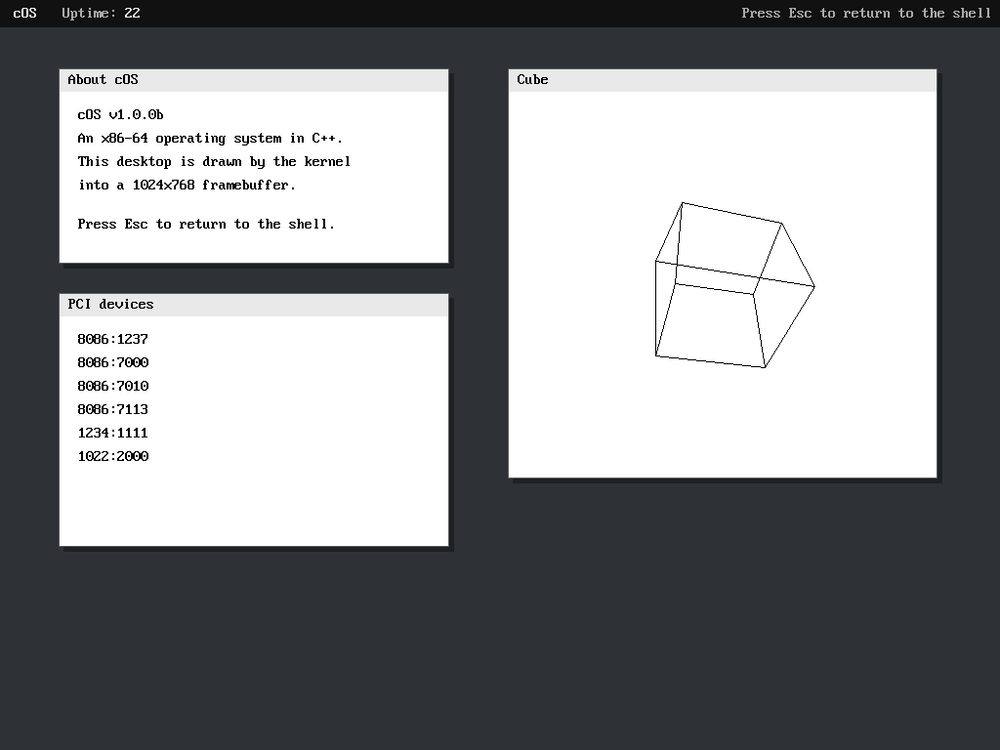
</p>

<p align="center">
<i>Screenshot of the desktop drawn by the gui command for test 5.2. </i>
</p>

<p align="center">
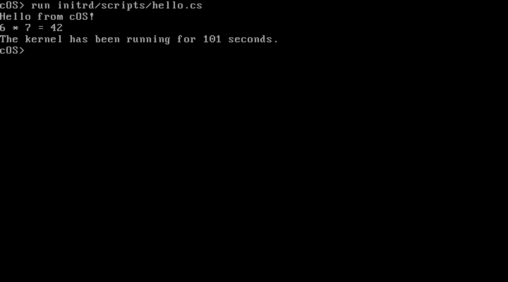
</p>

<p align="center">
<i>Screenshot of running initrd/scripts/hello.cs for test 5.3. </i>
</p>

```cpp
// Prints a greeting and some arithmetic.
var name = "cOS";
print("Hello from ", name, "!");
print("6 * 7 = ", 6 * 7);
print("The kernel has been running for ", uptime() / 1000, " seconds.");
```

<p align="center">
<i>Contents of initrd/scripts/hello.cs for test 5.3. </i>
</p>

<p align="center">
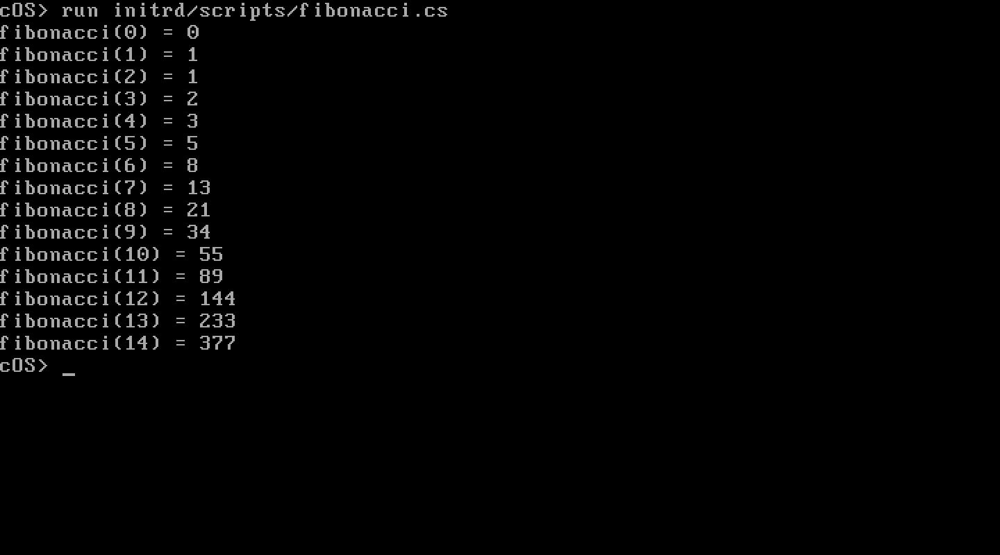
</p>

<p align="center">
<i>Screenshot of running initrd/scripts/fibonacci.cs for test 5.4. </i>
</p>

```cpp
// Prints the first Fibonacci numbers using a recursive function.
func fibonacci(n)
{
    if (n < 2) { return n; }
    return fibonacci(n - 1) + fibonacci(n - 2);
}

var i = 0;
while (i < 15)
{
    print("fibonacci(", i, ") = ", fibonacci(i));
    i = i + 1;
}
```

<p align="center">
<i>Contents of initrd/scripts/fibonacci.cs for test 5.4. </i>
</p>

<p align="center">
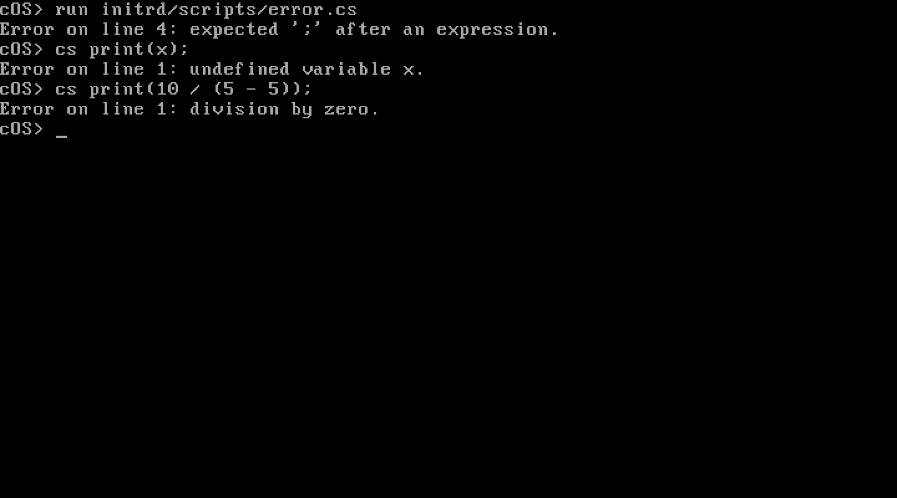
</p>

<p align="center">
<i>Screenshot of errors reported by the interpreter for test 5.5. </i>
</p>

```cpp
// This script has a syntax error on line 4, which the interpreter reports.
var total = 0;
total = total + 1;
print("total is ", total)
print("This line is never run.");
```

<p align="center">
<i>Contents of initrd/scripts/error.cs for test 5.5. </i>
</p>

<p align="center">
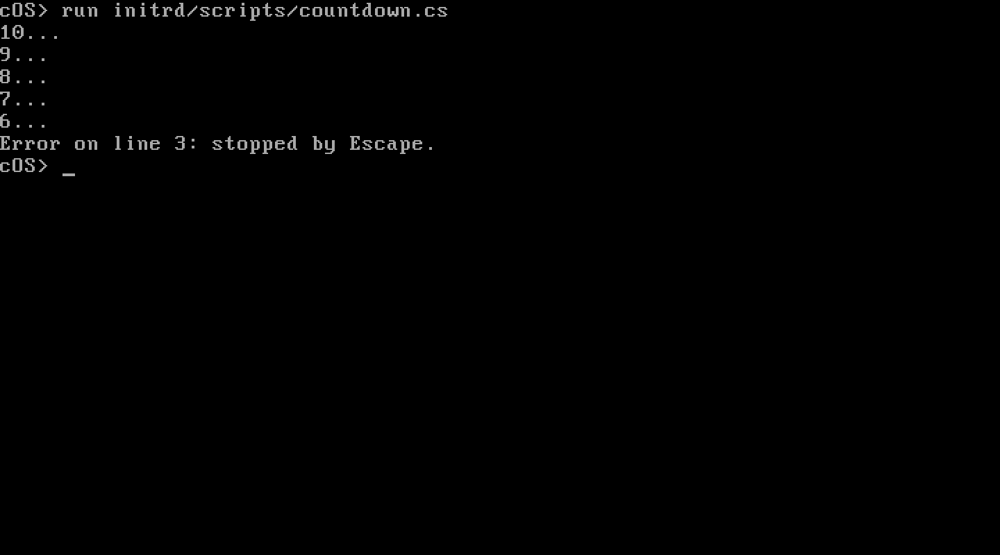
</p>

<p align="center">
<i>Screenshot of stopping initrd/scripts/countdown.cs with Escape for test 5.6. </i>
</p>

```cpp
// Counts down once a second, and can be stopped early with Escape.
var count = 10;
while (count > 0)
{
    print(count, "...");
    sleep(1000);
    count = count - 1;
}
print("Lift off!");
```

<p align="center">
<i>Contents of initrd/scripts/countdown.cs for test 5.6. </i>
</p>

<p align="center">
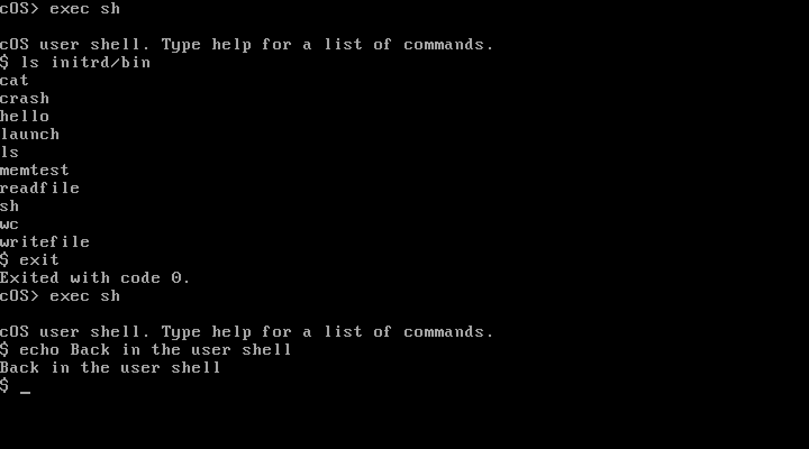
</p>

<p align="center">
<i>Screenshot of leaving and restarting the user shell for test 5.7. The shell's source is in <code>userspace/sh.cpp</code>. </i>
</p>


## Potential Improvements 

I have a few ideas on potential improvements to this project from my own reflection, which I will now discuss. 

- **Graphical User Interface (GUI)**: Providing a GUI would massively improve how users interact with the operating system. Currently, there is virtually no interactivity other than loading different programs. Using modern HD graphics would be ideal, however this would require implementing graphics drivers for each graphics card and this is infeasible. Instead, implementing HD graphics for the VMWare SVGA II card, which is a virtual graphics card that is available in most virtual machines, would likely be more than sufficient for people using an educational operating system.

- **Multiple Processors**: Modern operating systems utilise multiple processors (or cores) to execute processes or threads simultaneously as opposed to only using pre-emptive task switching. Implementing this may require a redesign of the scheduler and interrupts. However, locking primitives such as the spinlock are already functional with multiple processors, making much of the kernel and its data structures ready for multiple processors. This could be implemented with Symmetric Multiprocessing (SMP).

- **Improving system calls and porting a C library**: The system calls act as an interface between the user-space and the kernel, where the user-space can request services. Increasing the number of system calls means that user-space programs can provide more functionality. For example, a common system call is the mmap call which is used to map memory. With enough system calls, a C library can be ported that abstracts the system calls, leaving user-space programs to use the standardised C library.

- **Custom bootloader**: At the moment, we use the GRUB bootloader to load the operating system and Multiboot-2 modules into memory. However this restricts the design of how the kernel boots and makes us reliant on the bootloader. With a custom bootloader, we would have complete control over how our operating system is loaded and we could write a custom installer for our operating system.


## Resources

1 - OSDev Wiki (https://osdev.wiki/wiki/Expanded_Main_Page)

2 - Operating System Concepts, 10th edition (Abraham Silberschatz, Greg Gagne, and Peter Baer Galvin)
